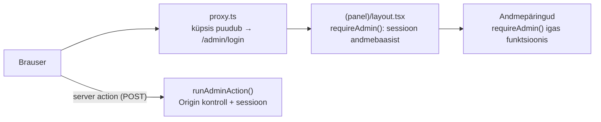

# Admin-liides

Poe haldusliides aadressil `/admin`. Selles dokumendis on kirjas, kuidas admin on üles ehitatud ja miks just nii. Dokument on mõeldud ka lõputöö kirjaliku osa allikaks.

> Andmebaasi skeem ja migratsioonid: [DATABASE.md](DATABASE.md). Üldarhitektuur: [ARCHITECTURE.md](ARCHITECTURE.md).

## 1. Ülevaade

| Leht | Aadress | Mida teeb |
| --- | --- | --- |
| Töölaud | `/admin` | Kataloogi, piltide, andmekvaliteedi, hindade ja süsteemi mõõdikud (ainult päris andmed) |
| Mudelid | `/admin/products/models` (+ `/[id]`) | Otsing, filtrid, sorteerimine, bulk-toimingud; mudeli andmete parandamine, staatus, esiletõstmine, kirjeldus |
| Konfiguratsioonid | `/admin/products/listings` (+ `/[id]`) | Tarnija pakkumised; riistvara, seisukorra, laoseisu, ostu- ja müügihinna parandamine |
| Pildid | `/admin/images` (+ `/[modelId]`) | Pildikate, põhipilt, järjekord, peitmine; Icecati toimingud |
| Andmekvaliteet | `/admin/data-quality` | Probleemide kategooriad → filtreeritud nimekiri → "Paranda" |
| Hinnastamine | `/admin/pricing` | Hinnareeglid, eelvaade, eraldi rakendamine kinnitusega |
| Sooduskoodid | `/admin/discounts` (+ `/new`, `/[id]`) | Koodid, tingimused, kehtivus, piirangud, eelvaade, duplikaat, arhiveerimine — vt §14 ja [DISCOUNTS.md](DISCOUNTS.md) |
| Seaded | `/admin/settings` | Üldine, pood, tarne, garantii, tagastus, usaldusriba |
| Tegevuslogi | `/admin/system/activity` | Kes muutis mida ja millal (vana → uus väärtus) |
| Logid | `/admin/system/logs` | Süsteemilogi (tase, allikas, aeg, otsing) |
| Tervis | `/admin/system/health` | Andmebaasi ühendus ja latentsus, migratsioonid, vead 24 h, keskkond |

Kliendid ja Tarnijad on menüüs märgitud **"Tulekul"**. Need ei ole klikitavad ega teeskle töötavat funktsiooni. **Tellimused** on aktiivne (§15).

## 2. Autentimine ja turvalisus

### Admini kasutaja loomine

Kasutajaid ei looda koodis ega seed-failis. Koodis pole ühtegi vaikeparooli.

```bash
npm run admin:create
```

Käsk küsib e-posti, nime ja parooli. Parool sisestatakse varjatult ja seda küsitakse kaks korda. Mitteinteraktiivselt (nt serveris) saab anda keskkonnamuutujad `ADMIN_EMAIL`, `ADMIN_NAME` ja `ADMIN_PASSWORD`. Parooli vahetus käib käsuga `npm run admin:create -- --reset-password`, mis lõpetab ka kõik vanad sessioonid. Kasutaja kustutamine: `npm run admin:delete -- <e-post>`.

Parooli nõuded: vähemalt 12 märki ja vähemalt 5 erinevat märki. Parool ei tohi sisaldada levinud sõnu (password, admin, qwerty …) ega e-posti aadressi.

### Kaitse kihid



1. **`src/proxy.ts`**: kiire, optimistlik kontroll. Kui sessiooniküpsist pole, suunatakse kasutaja sisselogimisele. Proxy lisab ka päised `X-Robots-Tag: noindex`, `X-Frame-Options: DENY` ja `Cache-Control: no-store`.
2. **Admini layout**: `requireAdmin()` kontrollib sessiooni andmebaasist iga päringu juures. Võltsitud või aegunud küpsis suunab sisselogimisele (testitud).
3. **Andmepöörduskiht (DAL)**: iga admini andmepäring kutsub ise `requireAdmin()`. Andmed ei leki ka siis, kui mõni leht kontrolli unustab.
4. **Iga server action** kutsub `runAdminAction()` → `requireAdminAction()`. Ainult layout'i kontrollist ei piisa, sest server action'it saab välja kutsuda otse POST päringuga.

### Sessioon

- Küpsises on juhuslik 256-bitine token. Andmebaasis (`admin_sessions`) hoitakse ainult selle **SHA-256 räsi**, seega andmebaasi leke ei võimalda sessioone üle võtta.
- Küpsis on `httpOnly`, `Secure` (productionis), `SameSite=Strict` ja `path=/`. Nimi on productionis `__Host-admin_session`: `__Host-` eesliide keelab alamdomeenidel küpsist üle kirjutada.
- Sessioon kehtib 8 tundi. Väljalogimine kustutab sessiooni ka serverist, mitte ainult küpsise.
- Deaktiveeritud admini sessioon kaotab kehtivuse kohe.

### Paroolid

Paroolid räsitakse **scrypt**-iga (Node.js sisseehitatud; N=2¹⁵, r=8, p=1, 16-baidine sool). scrypt on mälumahukas, mis teeb GPU-põhise ära arvamise kalliks. Parameetrid on räsi sees (`scrypt$N$r$p$sool$räsi`), nii et neid saab hiljem tõsta ilma vanu paroole kehtetuks tegemata. Võrdlus käib `timingSafeEqual`-iga. Kui e-posti pole olemas, kontrollitakse parooli "tühja" räsi vastu, et vastuse aeg ei reedaks, kas konto on olemas.

**Miks mitte bcrypt/argon2?** Need vajavad lisapaketti, argon2 puhul ka natiivset moodulit. scrypt on Node.js-is olemas ja OWASP-i soovitatud algoritmide hulgas.

### Sisselogimise piirang (rate limiting)

Katsed salvestatakse tabelisse `login_attempts`, nii et piirang kehtib ka mitme serverless-instantsi vahel (mälupõhine piirang Vercelis ei töötaks).

- Sama e-post: kuni 5 ebaõnnestunud katset 15 minuti jooksul.
- Sama IP: kuni 20 ebaõnnestunud katset 15 minuti jooksul.
- Veateade on alati üldine ("Vale e-post või parool"), et ründaja ei saaks teada, millised e-postid on olemas.

### Muud kaitsed

| Oht | Kaitse |
| --- | --- |
| CSRF | `SameSite=Strict` küpsis; Next.js-i server action'ite sisseehitatud Origin/Host kontroll; lisaks oma `assertSameOrigin()` igas toimingus |
| XSS | React escape'ib kogu väljundi; `dangerouslySetInnerHTML` adminis ei kasutata; HTML-i sisaldav sisend salvestub tekstina (testitud) |
| SQL injection | Drizzle'i parameetrid; otsingu `LIKE` metamärgid escape'itakse; toor-SQL ainult `sql\`\`` template'iga (testitud `'; DROP TABLE …` sisendiga) |
| Vigane sisend | Kõik vormid valideeritakse serveris zod-skeemiga, kliendi valideerimist ei usaldata. ID-d kontrollitakse UUID-na enne andmebaasi |
| Open redirect | `?next=` lubab ainult `/admin…` aadresse (`safeAdminRedirect`) |
| Clickjacking | `X-Frame-Options: DENY` |
| Vealeke | Kasutaja näeb ainult vea ID-d. Detail on serveri logis ja `system_logs` tabelis; stack trace'i ei saadeta |
| Saladused logis | `redact()` eemaldab võtmed nagu token/password/secret/cookie; ühendusstringid asendatakse `[DATABASE_URL]` |

## 3. ProductModel vs SupplierListing

```
ProductModel (mudel)                 SupplierListing (konfiguratsioon / tarnija pakkumine)
"Lenovo ThinkPad T14 Gen 3"   1 ── n  SP-10231: i5-1235U, 16 GB, 512 GB, A, 7 tk, 429 €
  - pildid (Icecat)                   SP-10232: i7-1255U, 32 GB, 1 TB, B, 2 tk, 549 €
  - identifikaatorid (GTIN/MPN)
  - kirjeldus, esiletõstmine
```

- **Pildid, kirjeldus ja esiletõstmine on mudeli tasemel.** Kõik sama mudeli konfiguratsioonid jagavad samu tootja pilte (Icecat).
- **Riistvara, seisukord, laoseis ja hind on konfiguratsiooni tasemel.**
- Avalik pakkumise ID (`mock-ms-10231`) ja meie SKU (`SP-10231`) jäid andmebaasi üleminekul samaks, seega ostukorvid ja lingid ei katkenud.
- Esiletõstmine on mudeli tasemel. Avalehel ja "Parimad pakkumised" all näidatakse igast esile tõstetud mudelist ühte konfiguratsiooni. Hardcode'itud SKU-sid enam pole.

## 4. Andmete omanik: tarnija vs admin

Tarnija sync (tulevikus Foxway) kirjutab andmed üle iga kord, kui tarnija feed muutub. Kui admin parandab vale väärtuse (nt tarnija ütleb klaviatuuri kohta "SWE", aga seade on "EST"), ei tohi järgmine sync parandust kustutada.

### Lahendus: tarnija väärtus + admini parandus

```
supplier_listings.keyboard          = "SWE"            ← tarnija väärtus (sync kirjutab)
supplier_listings.manual_overrides  = {"keyboard":"EST"} ← admini parandus (sync ei puutu)

efektiivne väärtus = väli on manual_overrides'is ? parandus : tarnija väärtus  →  "EST"
```

- Admin näeb igas vormis mõlemat väärtust: sisestusväljas on efektiivne väärtus, selle all "Tarnija: SWE", ja väljal on märk "Parandatud".
- **"Taasta"** eemaldab paranduse ja väli kasutab jälle tarnija väärtust.
- Kui admin sisestab tarnija väärtusega sama väärtuse, parandust ei salvestata (duplikaati pole mõtet hoida).
- Parandus võib olla ka `null`, kui tarnija väärtus on vale ja õiget pole teada. Siis on väli "puudub" ja Andmekvaliteet näitab seda probleemina.
- Pood, andmekvaliteedi kontrollid (SQL-is) ja hinnastamine kasutavad alati **efektiivset** väärtust.
- Korduv import/sync uuendab ainult tarnija veerge. Admini väljad ja parandused jäävad alles (testitud).

### Väljade omanikud

| Tarnija kontrollitud (admin saab parandada) | Ainult admin |
| --- | --- |
| **Konfiguratsioon:** CPU, CPU pere, CPU põlvkond, RAM, RAM tüüp, SSD, GPU, eraldi GPU, ekraan, resolutsioon, paneel, puuteekraan, klaviatuur, seisukord, laoseis, ostuhind, OS, garantii (kuud), aku seisukord, laadija | **Konfiguratsioon:** müügihind, staatus |
| **Mudel:** tootja, seeria, mudel, põlvkond, ekraan, kaal | **Mudel:** staatus, esiletõstmine, kirjeldus |
| | **Pildid:** põhipilt, järjekord, peitmine |
| | **Seaded**, hinnareeglid |

Nimekirjad on koodis: `src/domain/catalog/overrides.ts`.

### Nähtavus (staatus)

`ACTIVE`: poes nähtav. `HIDDEN`: peidetud, aga andmed alles. `ARCHIVED`: arhiveeritud. Poes on pakkumine nähtav ainult siis, kui mudel ja pakkumine on mõlemad `ACTIVE`, laoseis on > 0 ja kõik poe kohustuslikud andmed on olemas (CPU, RAM, SSD, seisukord, müügihind, ekraan, tootja). Puudulik pakkumine ei kao andmebaasist: see jääb Andmekvaliteedi alla parandamiseks.

**Kustutamist adminis pole** (ka mitte bulk-toimingutes). Peitmine on alati tagasi pööratav ja ajalugu jääb alles.

## 5. Hinnastamine

Müügihind = ostuhind + tarnija transport + garantiireserv + juurdehindlus (vahemiku järgi) + käibemaks (tava- või kasutatud kauba erikord) + makseteenuse tasu, ümardatuna (nt …9 €). Kui kasum jääb alla miinimumi (€ või % — kehtib suurem), tõstetakse hinda. Arvutus on `src/domain/pricing/pricing-engine.ts`-is ja see on unit-testitud.

Adminis on kolm eraldi sammu:

1. **Reeglid:** kulud, kaitsepiirid (min kasum €/%, min müügihind), ümardus ja juurdehindluse vahemikud ostuhinna järgi. Vahemikud valideeritakse: algus 0 €-st, ilma aukude ja kattumisteta, ainult viimane võib olla ülemise piirita. **Salvestamine ei muuda ühtegi hinda.**
2. **Eelvaade:** tabel veergudega SKU, ostuhind, praegune hind, arvutatud hind, erinevus ja kasum (marginaal). Pakkumised, mida ei saa hinnastada (puudub ostuhind või käibemaksu režiim), on näidatud põhjusega ja jäetakse vahele.
3. **Rakenda hinnad:** eraldi nupp kinnitusdialoogiga, mis näitab muutuvate hindade arvu. Rakendamine käib ühes tehingus ja iga hinnamuutus läheb tegevuslogisse (`pricing.apply`, vana → uus).

Müügihinda saab muuta ka käsitsi konfiguratsiooni lehel. Järgmine "Rakenda hinnad" arvutab selle siiski reeglite järgi üle. Nii on hinnad alati reeglitega kooskõlas, ja kui erand on vajalik, tuleb seda arvestada.

## 6. Tegevuslogi (audit log)

Iga muutev toiming kirjutab `audit_logs` tabelisse rea: admin, tegevus (nt `listing.update`, `image.hide`, `icecat.manual_match`, `pricing.apply`, `settings.update`, `auth.login`), objekt ja **ainult muutunud väljad kujul `{ väli: { from, to } }`**.

- Audit kirjutatakse **samas andmebaasi tehingus** muudatusega. Muudatust ilma auditikirjeta ei saa tekkida.
- Admini e-post salvestatakse ka tekstina. Kui admin kustutatakse, jääb logi loetavaks (`admin_user_id` → `NULL`).
- CLI toimingud (`admin:create`, `admin:delete`) logitakse samuti; admini veerus on siis "CLI".
- Mudeli ja konfiguratsiooni lehelt viib link "Muudatuste ajalugu" selle objekti logini.

**Süsteemilogi** (`system_logs`) on eraldi: tehnilised sündmused allikatega `APPLICATION`, `DATABASE`, `ADMIN`, `AUTH` ja `ICECAT`. Igal veal on lühike vea ID, mida kasutaja näeb veateates ja mille järgi saab logist otsida. Tarnija sync logisid veel pole, sest tarnijat pole ühendatud. Võltslogisid ei kuvata.

## 7. Icecat adminis

| Toiming | Mida teeb | Kus töötab |
| --- | --- | --- |
| **Otsi uuesti** | Käib identifikaatorid uuesti läbi (GTIN → MPN → Icecat ID). Lokaalselt laeb leitud pildid ka alla | Lokaalselt täielikult; Vercelis ainult vaste info |
| **Värskenda pilte** | Laeb kinnitatud vaste pildid uuesti alla (thumbnail/medium/large WebP) | Ainult lokaalselt |
| **Käsitsi vaste** | 1) Admin sisestab Icecat ID → **eelvaade** näitab Icecati toote nime, tootjat, piltide arvu ja hoiatust, kui nimi ei vasta mudelile. 2) Alles kinnitamisel salvestatakse `CONFIRMED_ICECAT_ID` | Kõikjal |
| **Eemalda käsitsi vaste** | Eemaldab kinnituse ja **peidab** selle vaste pildid poest (faile ei kustutata), staatus → `NEEDS_REVIEW` | Kõikjal |
| **Vaata kandidaati** | Madala kindlusega vaste (`NEEDS_REVIEW`) puhul avab eelvaate ja kinnitusdialoogi | Kõikjal |

**Madala kindlusega vaste ei lähe kunagi automaatselt live'i.** Nimepõhine vaste (kindlus 0,7) või vaste, mille pealkiri ei klapi (nt T14 vs T14s), jääb staatusesse `NEEDS_REVIEW`, kuni admin selle kinnitab. Vale pilt poes on halvem kui placeholder.

**Miks allalaadimine ainult lokaalselt?** Vercelis pole failisüsteem püsiv: allalaaditud fail kaoks järgmise deploy'ga. Testversioonis on pildid Git'is (`public/media/products`). Püsiva objektisalvestuse (S3-ühilduv, nt Cloudflare R2) lisamisel töötab allalaadimine ka productionis. Selleks piisab uuest `ImageStorageAdapter`-ist; impordi loogika jääb samaks. Samal põhjusel on **käsitsi üleslaadimine märgitud "Tulekul"**.

Icecati import kasutab nüüd `DbImageRepository`-t (PostgreSQL), mis on sama liidesega nagu varasem JSON-hoidla. Impordi loogika ei muutunud. Korduv import ei muuda admini valitud järjekorda, põhipilti ega peitmist.

## 8. Andmekvaliteet

Kontrollid töötavad SQL-is **efektiivsete väärtuste** järgi, seega parandatud väli pole enam probleem:

| Mudelid | Konfiguratsioonid |
| --- | --- |
| Ilma nähtava pildita | Puudub protsessor / CPU põlvkond / RAM / SSD / seisukord |
| Icecat: ei leitud | Tundmatu klaviatuur |
| Icecat: vajab ülevaatust | Puudub müügihind / laoseis |

Iga kategooria näitab probleemide arvu ja osakaalu. Klõps kategoorial avab filtreeritud nimekirja (`?issue=…`) ja sealt viib "Paranda" detailvaatesse. Samu kontrolle näitavad ka detailvaated ja töölaud ("Suurimad andmeprobleemid").

## 9. Seaded

Seaded on tabelis `store_settings` (võti → JSON), iga grupp valideeritakse zod-skeemiga (`src/domain/settings/settings.ts`). Vigane väärtus andmebaasis asendatakse vaikeväärtusega, nii et vigane seade poodi maha ei too.

- **Üldine:** poe nimi, e-post, telefon, ettevõtte nimi, registrikood, aadress (tühi = ei kuvata)
- **Pood:** prototüübirežiim (hoiatusriba + noindex), valuuta, keel
- **Tarne / Garantii / Tagastus:** poe üldtekstid
- **Usaldusriba:** iga väite nähtavus, tekst ja järjekord

**Seaded ei väljamõtle pakkumise andmeid.** Poe üldine garantiitekst ei tähenda, et igal seadmel on see garantii. Pakkumise garantii, aku seisukord ja laadija tulevad ainult tarnijalt, ja kui väärtus puudub, seda ei kuvata.

## 10. Vahemälu ja poe uuendamine

Pood loeb kataloogi ja seadeid läbi `'use cache'` + `cacheTag('catalog')` / `cacheTag('settings')`. Iga admini muudatus kutsub server action'is `updateTag(…)`, nii et poodi jõuab muudatus kohe (testitud: peidetud mudel → tooteleht "Toodet ei leitud" järgmisel päringul). Admini enda lehed ei kasuta vahemälu ja loevad alati värsked andmed.

## 11. Komponendid ja mobiil

Taaskasutatavad komponendid on kaustas `src/components/admin/`: `AdminShell` (külgmenüü, mis on desktopil kokkuklapitav ja mobiilis drawer), `PageHeader` + `AdminBreadcrumbs`, `DataTable`, `Pagination`, `FilterForm` / `SearchField` / `SelectFilter`, `BulkActionBar`, `StatusBadge`, `MetricCard`, `EmptyState`, `ErrorState`, `LoadingState`, `ConfirmDialog`, `EntityEditForm`, `ToastProvider`.

- `DataTable` on desktopil tabel ja **mobiilis kaardid**, nii et 375 px laiusel 12-veerulist tabelit ei kuvata. Horisontaalset kerimist pole (kontrollitud: töölaud, nimekirjad, hinnastamine, seaded).
- Filtrid on tavalised GET-vormid: URL on jagatav ja töötab ka ilma JavaScriptita.
- Puuduv väärtus kuvatakse alati kui **"Puudub"**, mitte väljamõeldud väärtusena.

## 12. Testid

| Fail | Mida kontrollib |
| --- | --- |
| `src/server/db/database.test.ts` | Ühendus, migratsioon (12 tabelit), import = allika arvud, idempotentsus, admini muudatused säilivad korduval impordil |
| `src/server/auth/auth.test.ts` | scrypt, nõrgad paroolid, open redirect, proxy, sessioonid (räsi, aegumine, logout, deaktiveerimine), piirang e-posti ja IP järgi |
| `src/server/auth/csrf.test.ts` | Päritolu kontroll, toiming ilma sessioonita |
| `src/server/admin/admin.test.ts` | Parandused vs tarnija väärtus, Taasta, väljavead, bulk, pildid, andmekvaliteet, hinnastamine, seaded, audit, turvalisus |
| `src/domain/admin/admin-domain.test.ts` | Vahemike valideerimine, hindade eelvaade, vormid, audit diff, logide redigeerimine |
| `src/server/catalog/db-catalog-mapper.test.ts`, `src/domain/catalog/overrides.test.ts` | Andmebaasi read → poe kirjed, efektiivsed väärtused, nähtavus |

Andmebaasi testid jooksevad **päris PostgreSQL-is ajutises skeemis** (`test_xxxx`), mis kustutatakse testi lõpus. Poe andmeid testid ei puuduta. Kui `DATABASE_URL` puudub, jäetakse need testid vahele.

## 13. Lõputöö jaoks olulised otsused

1. **Drizzle, mitte Prisma** (vt [DATABASE.md](DATABASE.md#orm-valik-drizzle)).
2. **Andmebaasi sessioonid JWT asemel:** sessiooni saab serverist kohe lõpetada (logout, parooli vahetus, deaktiveerimine). JWT kehtiks kuni aegumiseni.
3. **Parandused eraldi JSONB-veerus, mitte veergude ülekirjutamine:** tarnija ja admini andmed ei konkureeri ning sync ja admin saavad töötada samaaegselt.
4. **Audit samas tehingus:** logi on usaldusväärne, sest muudatus ja selle kirje kas õnnestuvad mõlemad või ebaõnnestuvad mõlemad.
5. **Eelvaade enne hindade muutmist:** hinnamuudatus mõjutab kõiki tooteid korraga, seega peab admin enne nägema, mis muutub.
6. **Järkjärguline üleminek:** pood loeb andmebaasist ainult siis, kui `DATABASE_URL` on seadistatud. Ilma selleta kasutatakse mock-andmeid (lokaalne arendus, CI). Andmebaasi viga ei vaheta vaikselt mock-andmetele: see logitakse ja kasutaja näeb veateadet vea ID-ga.

## 14. Sooduskoodid

Täielik kirjeldus: [DISCOUNTS.md](DISCOUNTS.md). Adminis:

- **Nimekiri** (`/admin/discounts`): kood, nimi, tüüp, soodustus, kehtivus (Eesti aeg), kasutus `kinnitatud / piirang` ja **tegelik staatus** (Ajastatud / Aktiivne / Aegunud arvutatakse kuupäevadest). Otsing koodi ja nime järgi, filtrid staatuse ja tüübi järgi, järjestus. Mobiilis kaardid.
- **Vorm** (`/new`, `/[id]`) jaguneb osadeks: Põhiinfo (kood + „Genereeri“, nimi, märkmed), Soodustus (tüüp, väärtus, maksimum), Tingimused (miinimumsumma, kehtivusala, välistused otsinguga), Kehtivus (Eesti aeg), Kasutus ja kaitse (piirang, marginaalikaitse), loomisel ka Olek (mustand/aktiivne). Valideerimine käib brauseris ja serveris sama skeemiga. Salvestusnupp on lukus, kuni leht on laaditud.
- **Kiirtoimingud:** muuda, duplikeeri (alati mustand uue koodiga), aktiveeri / lülita välja, arhiveeri (kinnitusega). Kustutamist pole.
- **Eelvaade** („Testi koodi“): test-summa või valitud konfiguratsioonid → soodustus, lõppsumma, millistele ridadele kood rakendub ja kas marginaalikaitse vähendas soodustust. Mustandit saab testida; eraldi näidatakse, kas kood kehtiks praegu poes.
- **Audit:** loomine, muutmine (vana → uus, sh valikud), aktiveerimine, väljalülitamine, arhiveerimine, duplikaat.
- **Töölaud:** aktiivsed / ajastatud / aegunud koodid.

## 15. Tellimused

Täielik kirjeldus: [ORDERS.md](ORDERS.md#12-admin).

- **`/admin/orders`:** otsing (number, e-post, nimi), filtrid (olek, makse, test/päris, kuupäevad, sooduskood) ja järjestus. **TEST** märk; testtellimustel rohelisi „makstud“ märke pole.
- **`/admin/orders/[id]`:** tooted (snapshot), summad, klient, tarne, sooduskoodi snapshot, ajalugu ja sisemärkmed.
- **Toimingud:** ainult **tühistamine** (kinnitusega) ja **sisemärkmed** (ainult lisamine). Makset (PAID) admin käsitsi märkida ei saa — see tuleb makse faasis makseteenuselt.
- **Audit:** `order.cancel` (vana → uus olek, vabastatud reserveeringud), `order.note_added` (ilma märkuse tekstita, sest see võib sisaldada isikuandmeid). Tellimuse vaatamist ei logita.
- **Töölaud:** testtellimusi täna ja kokku ning päris tellimused eraldi. Käivet ei näidata.
- **Seaded → Tarne:** tarneviisi nimi ja hind (kassa „Standardtarne“) ning tasuta tarne piir.

