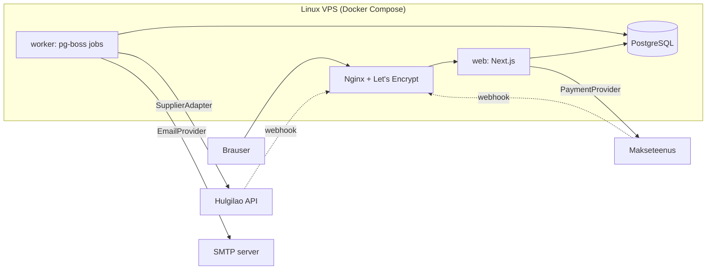

# Arhitektuur

## Põhimõte: modulaarne monoliit

Üks Next.js rakendus, üks PostgreSQL andmebaas ja üks taustatööde worker, mis kasutab **sama koodibaasi**. Kood on jaotatud **äridomeeni järgi** (kataloog, hinnastamine, tarnija, tellimused, maksed), mitte tehnilise kihi järgi.

Miks mitte mikroteenused: üks arendaja, üks server, üks andmebaas. Mikroteenused lisaksid võrgukõnesid, eraldi deploy'sid ja hajusaid tehinguid — keerukust, mis ei too siin kasu. Moodulite piirid on koodis selged, nii et vajadusel saab mõne mooduli hiljem eraldi teenuseks tõsta.



## Arhitektuurireeglid

1. **Brauser ei räägi kunagi tarnijaga.** Andmevoog on alati: tarnija API → worker (sync) → PostgreSQL → Next.js → brauser. Põhjused: API võti jääb serverisse, rate limit'id ei sõltu külastajate arvust, filtrid töötavad meie indeksitel, SEO saab serveris renderdatud HTML-i, ja tarnija downtime ei too poodi maha.
2. **Hinda arvutab ainult server.** Brauser saadab ainult toote ID ja koguse. Hind, tarne ja kogusumma arvutatakse serveris iga kord uuesti.
3. **Välised teenused on liidese (interface) taga.** `SupplierAdapter`, `PaymentProvider`, `EmailProvider`, `ShippingProvider`. Äriloogika ei impordi kunagi konkreetset pakkujat otse.
4. **Tellimuse andmed on snapshot.** `OrderItem` salvestab ostu hetke nime, spetsifikatsiooni, hinna ja KM info — vana tellimus ei muutu, kui toode muutub.
5. **Iga välise sammu jaoks eraldi staatus.** Tellimusel pole `done: boolean`; on `OrderStatus`, `PaymentStatus`, `SupplierOrderStatus`, `ShipmentStatus`.
6. **Idempotentsus.** Iga väline kõrvalmõjuga operatsioon (tarnija tellimus, e-kiri, raha tagastus) kasutab unikaalset võtit, mis salvestatakse **enne** välist kõnet.

## Kaustastruktuur

```
src/
  app/                    Next.js route'id (ainult "liim": loe parameetrid, kutsu teenust, renderda)
    (shop)/...            avalik pood
    admin/...             admin (Phase 3)
    api/...               route handler'id (autocomplete, webhook'id)
  components/             UI komponendid (vt PROJECT_PLAN.md §6)
  domain/                 puhas äriloogika — ei sõltu Next.js-ist ega andmebaasist, kergesti testitav
    catalog/              tüübid, filtrid, otsing, sorteerimine, facet'id
    grade/                seisukorra klassid
    pricing/              hinnastamismootor
    money/                sentides arvutamine ja vormindamine
    use-cases/            "Leia sobiv" filtrieelistused
  server/                 serveripoolsed teenused ja andmepääs ("server-only")
    catalog/              CatalogRepository liides + implementatsioon
    cart/                 ostukorvi arvutus serveris
  integrations/           välised süsteemid adapterite taga
    supplier/             SupplierAdapter, normaliseerimine, MockSupplierAdapter
    payment/              PaymentProvider (Phase 6)
    email/                EmailProvider (Phase 7)
    shipping/             ShippingProvider (Phase 5)
  config/                 poe seadistus (prototüübis fail, Phase 3-st andmebaasis)
  client/                 brauseripoolsed store'id (ostukorv, võrdlus)
```

Reegel: `domain/` ei impordi kunagi `server/`, `app/` ega `components/`. `components/` ei impordi `server/`-i (andmed tulevad props'ina või server action'i kaudu).

## Kataloogi andmevoog (Phase 1 vs hiljem)

```
Phase 1 (praegu):
  MockSupplierAdapter.getProducts()  → normalizeSupplierProduct() → priceOffer() → in-memory CatalogRepository

Phase 2+:
  worker: SupplierAdapter.getProducts() → normalize → priceOffer() → PostgreSQL (upsert)
  web:    PrismaCatalogRepository → 'use cache' + cacheTag('catalog') → lehed
```

Prototüüp läbib juba praegu sama ahela (tarnija toorandmed → normaliseerimine → hinnastamine → kataloog). Phase 2-s vahetatakse ainult `CatalogRepository` implementatsioon; lehed ja komponendid ei muutu.

## Hulgilao integratsioon

```ts
interface SupplierAdapter {
  readonly code: string;                     // "mock", "supplier-a"
  getProducts(): Promise<SupplierProduct[]>;
  getProduct(externalId: string): Promise<SupplierProduct | null>;
  getAvailability(externalId: string): Promise<SupplierAvailability>; // hind + laoseis koos
  createOrder(input: SupplierOrderInput): Promise<SupplierOrderResult>;
  getOrderStatus(supplierOrderId: string): Promise<SupplierOrderStatus>;
  getTracking(supplierOrderId: string): Promise<TrackingInfo | null>;
}
```

Muudatus algse spetsifikatsiooniga võrreldes: `getStock` ja `getPrice` on ühendatud `getAvailability`-ks, sest checkout'i kontrolliks on vaja mõlemat korraga ja see säästab rate limit'i.

`SupplierProduct` on **tarnija toorandmed** (zod-skeemiga valideeritud). Iga adapter tõlgib oma tarnija formaadi meie normaliseeritud kujule (`NormalizedOffer`) — ülejäänud rakendus tarnija formaati ei näe.

### Sync (Phase 4)

1. Worker käivitab `catalog.sync` töö seadistatud intervalliga (`SystemSetting.syncIntervalMinutes`), singleton-režiimis (kaks sync'i korraga ei jookse).
2. Luuakse `SyncRun` (status `RUNNING`).
3. Tarnijalt loetakse kõik tooted (lehekülgede kaupa, rate limit'i arvestades).
4. Iga toode: valideeri → normaliseeri → leia/loo `Product` + `ProductVariant` → upsert `SupplierListing` → kui ostuhind muutus, kirjuta `PriceHistory` → arvuta müügihind → kui laoseis muutus, kirjuta `StockHistory`.
5. Tooted, mida selles sync'is ei olnud: `SupplierListing.status = MISSING`, laoseis 0. **Ei kustutata.** Kui sama SKU tagasi tuleb, aktiveeritakse uuesti.
6. Vead ei katkesta kogu sync'i: üksiku toote viga → `SyncError` rida, jätkatakse.
7. `SyncRun` lõpetatakse: kestus, loendurid, staatus (`SUCCESS`, `PARTIAL`, `FAILED`).
8. Cache tühistatakse (`revalidateTag('catalog')`).

Kui tarnija API on maas: sync märgitakse `FAILED`, pood töötab edasi viimaste andmetega. Kui viimane edukas sync on liiga vana, kuvab admin hoiatuse ja "Laoseis uuendatud X min tagasi" näitab ausat aega.

## Hinnastamismootor

Asub `src/domain/pricing/`. Puhas funktsioon, täielikult unit-testitud.

```
ostuhind (neto)
 + transport tarnijalt
 + garantiiriski reserv (% ostuhinnast)
 + juurdehindlus (hinnavahemiku reegel: fikseeritud € ja/või %)
 = neto müügihind
 + käibemaks (tavakord: kogu summalt; erikord: ainult juurdehindluselt)
 + makseteenuse tasu (% + fikseeritud, "gross-up")
 = toorhind
 → ümardamine hinnapsühholoogia reegliga (alati üles, nt 423.62 → 429, 497 → 499)
 → kaitse: kui kasum < minimaalne kasum (€ ja %), tõsta hinda; kui hind ikkagi ebaloogiline → viga, toodet ei müüda
```

Kõik summad sentides. Reeglid tulevad Phase 3-st andmebaasist (`PricingRule`), prototüübis `src/config/pricing.ts`.

## Tellimuse elutsükkel (Phase 5–7)

```
Order.status:          PENDING_PAYMENT → PAID → SUPPLIER_ORDERED → SHIPPED → DELIVERED
                                        ↘ ATTENTION_REQUIRED (admin)  ↘ CANCELLED / REFUNDED
Payment.status:        CREATED → PENDING → PAID | FAILED | CANCELLED → (REFUNDED)
SupplierOrder.status:  QUEUED → SUBMITTING → ACCEPTED → PROCESSING → SHIPPED
                                ↘ FAILED (retry administ)  ↘ UNKNOWN (timeout — kontrolli enne uut katset!)
```

Idempotentsus:

- **Makse webhook** kaks korda: `Payment` uuendatakse tingimusel `status != PAID` (andmebaasi tasemel). Teine kord ei muuda midagi ega loo uut tööd. Webhook'i allkiri verifitseeritakse ja makse staatus kontrollitakse pakkuja API-st üle (ei usaldata ainult webhook'i keha).
- **Tarnija tellimus:** `SupplierOrder` rida luuakse unikaalse `idempotencyKey`-ga (= meie tellimuse number) **enne** API kõnet. Kui kõne timeout'ib → staatus `UNKNOWN`, järgmine samm on `getOrderStatus` meie viite järgi, mitte uus `createOrder`.
- Automaatseid retry'sid on piiratud arv (nt 3, kasvava viivitusega); pärast seda `ATTENTION_REQUIRED` ja admin otsustab.

## Turvalisus (kokkuvõte)

| Oht | Kaitse |
| --- | --- |
| SQL injection | Prisma parametriseeritud päringud; toor-SQL ainult `$queryRaw` template'iga |
| XSS | React escape'ib; `dangerouslySetInnerHTML` ainult JSON-LD jaoks (serialiseeritud, `<` escape'itud) |
| CSRF | Server Actions kontrollivad Origin päist; cookie'd SameSite=Lax |
| Hinna võltsimine | Hind arvutatakse alati serveris |
| Makse võltsimine | Webhook allkiri + staatus pakkuja API-st |
| Tarnija võltsimine | Tarnija webhook'il jagatud saladus/allkiri; andmed valideeritakse zod-iga |
| Admin | Serveripoolne sessioonikontroll, argon2id, rate limit |
| Saladused | Ainult `.env` (ei commit'ita), valideeritakse käivitamisel (`src/config/env.ts`) |
| Failid | Admin upload: tüübi ja suuruse kontroll, uus failinimi, ei serveerita käivitatavana |

## Mida me ei kasuta

| Tehnoloogia | Miks mitte praegu |
| --- | --- |
| Redis | pg-boss teeb järjekorra PostgreSQL-is; cache on Next.js-is |
| Elasticsearch / Algolia | PostgreSQL `pg_trgm` + `tsvector` piisab kümnete tuhandete toodete jaoks |
| GraphQL | Server Components loevad andmeid otse; avalikku API-t pole vaja |
| Kubernetes / mikroteenused | Üks server, üks arendaja |
| Event sourcing / CQRS | Staatuste ajalugu salvestame lihtsalt `OrderEvent` tabelisse |

Kui mõni neist kunagi päriselt vajalikuks muutub, on moodulite piirid olemas.
