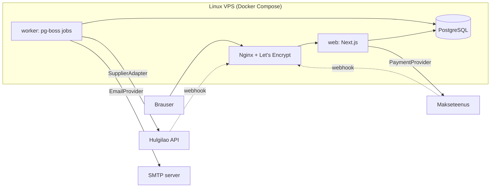

# Arhitektuur

## Põhimõte: modulaarne monoliit

Üks Next.js rakendus, üks PostgreSQL andmebaas ja üks taustatööde worker, mis kasutab **sama koodibaasi**. Kood on jaotatud **äridomeeni järgi** (kataloog, hinnastamine, tarnija, tellimused, maksed), mitte tehnilise kihi järgi.

Miks mitte mikroteenused: üks arendaja, üks server, üks andmebaas. Mikroteenused lisaksid võrgukõnesid, eraldi deploy'sid ja hajusaid tehinguid — keerukust, mis ei too siin kasu. Moodulite piirid on koodis selged, nii et vajadusel saab mõne mooduli hiljem eraldi teenuseks tõsta.



## Arhitektuurireeglid

1. **Brauser ei räägi kunagi tarnijaga.** Andmevoog on alati: tarnija API → worker (sync) → PostgreSQL → Next.js → brauser. Põhjused: API võti jääb serverisse, rate limit'id ei sõltu külastajate arvust, filtrid töötavad meie indeksitel, SEO saab serveris renderdatud HTML-i, ja tarnija downtime ei too poodi maha.
2. **Hinda arvutab ainult server.** Brauser saadab ainult toote ID ja koguse. Hind, tarne ja kogusumma arvutatakse serveris iga kord uuesti.
3. **Välised teenused on liidese (interface) taga.** `SupplierAdapter`, `PaymentProvider`, `EmailProvider`, `ShippingProvider`. Äriloogika ei impordi kunagi konkreetset pakkujat otse.
4. **Tellimuse andmed on snapshot.** `OrderItem` salvestab ostu hetke nime, spetsifikatsiooni, hinna ja KM info — vana tellimus ei muutu, kui toode muutub.
5. **Iga välise sammu jaoks eraldi staatus.** Tellimusel pole `done: boolean`; on `OrderStatus`, `PaymentStatus`, `SupplierOrderStatus`, `ShipmentStatus`.
6. **Idempotentsus.** Iga väline kõrvalmõjuga operatsioon (tarnija tellimus, e-kiri, raha tagastus) kasutab unikaalset võtit, mis salvestatakse **enne** välist kõnet.

## Kaustastruktuur

```
src/
  app/                    Next.js route'id (ainult "liim": loe parameetrid, kutsu teenust, renderda)
    (shop)/...            avalik pood
    admin/login/          admini sisselogimine
    admin/(panel)/...     kaitstud admin (layout kontrollib sessiooni) — vt docs/ADMIN.md
    api/...               route handler'id (autocomplete, webhook'id)
  components/             UI komponendid (vt PROJECT_PLAN.md §6)
  domain/                 puhas äriloogika — ei sõltu Next.js-ist ega andmebaasist, kergesti testitav
    catalog/              tüübid, filtrid, otsing, sorteerimine, facet'id
    grade/                seisukorra klassid
    pricing/              hinnastamismootor
    money/                sentides arvutamine ja vormindamine
    finder/               "Leia sobiv" deterministlik soovitaja (+ avalehe eesmärgi parameeter ?eesmark=)
    storefront/           poe tekstid ja salongi faktid (prototüübiriba, salongi arv/aadress, hero CTA-d)
    admin/                admini vormide valideerimine, andmekvaliteedi reeglid, hindade eelvaade
    settings/             poe seadete zod-skeemid ja vaikeväärtused
    discounts/            DiscountEngine, koodi normaliseerimine, admini vormi valideerimine
    time/                 Eesti aeg ↔ UTC
  server/                 serveripoolsed teenused ja andmepääs ("server-only")
    catalog/              kataloogi teenus (PostgreSQL või mock) + andmebaasi read → poe kirjed
    cart/                 ostukorvi arvutus serveris
    db/                   Drizzle skeem, ühendus, import (seed)
    auth/                 paroolid, sessioonid, piirang, sisse-/väljalogimine
    admin/                admini päringud (DAL) ja server action'id, audit
    settings/             poe seaded andmebaasist (vahemäluga)
    logging/              struktureeritud logi + system_logs
    discounts/            sooduskoodi laadimine, ostukorvi kontroll, piirang, kasutused (redemptions)
    checkout/             kassa arvutus (computeCheckout) ja server action'id
    orders/               tellimuse loomine (idempotentne tehing), avalik vaade, otsing, teavitused (Noop), seadmete/seerianumbrite määramine (admin)
    payments/             PaymentProvider liides (praegu ühtegi pakkujat pole)
    catalog-sync/         tarnija sync (Laptopid.ee, Tech): lukk + käivitused, pildi mõõdud, ajastatud otspunkti kaitse
  integrations/           välised süsteemid adapterite taga
    supplier/             SupplierAdapter, normaliseerimine, MockSupplierAdapter
    laptopid/             Laptopid.ee API klient (server-only), skeem, normaliseerimine, snapshot'i kontroll
    tech/                 Tech hinnakiri: XLSX allalaadimine/lugemine (ExcelJS, server-only), tabid/sektsioonid, värvid, märkused, grupid
    payment/              PaymentProvider (Phase 6)
    email/                EmailProvider (Phase 7)
    shipping/             ShippingProvider (Phase 5)
  config/                 tehnilised seaded (SITE_URL, hinnastamise algväärtused); poe seaded on andmebaasis
  proxy.ts                admini optimistlik kaitse (Next.js 16 "middleware")
  client/                 brauseripoolsed store'id (ostukorv, võrdlus)
```

Reegel: `domain/` ei impordi kunagi `server/`, `app/` ega `components/`. `components/` ei impordi `server/`-i (andmed tulevad props'ina või server action'i kaudu).

## Kataloogi andmevoog

```
Praegu (andmebaasi etapp):
  import:  MockSupplierAdapter → normaliseerimine → hinnastamine → PostgreSQL (npm run db:seed, idempotentne upsert)
  pood:    PostgreSQL (catalog-queries.ts: filtrid + tahud + LIMIT SQL-is) → db-catalog-mapper (ainult leitud mudelid)
           → 'use cache' + cacheTag('catalog') → lehed / GET /api/catalog (filtriklikk)
  admin:   server action → valideerimine → tehing (muudatus + audit) → updateTag('catalog') → pood näeb kohe

Ilma DATABASE_URL-ita (lokaalne arendus, CI):
  MockSupplierAdapter → normaliseerimine → hinnastamine → mälus olev kataloog

Järgmine etapp (tarnija sync):
  worker: SupplierAdapter (Foxway) → normaliseerimine → upsert ainult tarnija veergudesse → updateTag('catalog')
```

### Kataloogi päringud (jõudluse sprint 2026-10-12)

Varem luges iga kataloogi-, filtri- ja tootelehe päring **kogu kataloogi** (504 pakkumist + 1451 pildirida, ~2 MB JSON) ja filtreeris mälus. `'use cache'` seda ei päästnud: Verceli serverless'is ei püsi mälu-vahemälu päringute vahel (Next docs → `use cache` → Serverless), nii et tegelikult loeti kogu kataloog peaaegu igal päringul.

Nüüd (Laptopid.ee vana filtri põhimõte, aga parameetritega SQL ja tüübitud JSON):

```
filtriklikk → history.pushState (URL jagatav, tagasi-nupp töötab)
  → GET /api/catalog?brand=lenovo&ram=16   (eelmine päring katkestatakse: AbortController)
  → ÜKS paralleelne andmebaasiring:
       1. lehekülje ID-d:  storefront CTE → WHERE filtrid → ORDER BY → LIMIT 24 OFFSET n (+ count(*) OVER())
       2. tahud:           üks UNION ALL päring (iga tahk: kõik teised filtrid, GROUP BY)
       3. kaardi andmed + pildid ainult (1) mudelite kohta (sama mapper, mis varem)
  → JSON: 24 kaarti (toCardItem) + tahud ≈ 70 KB / ~5 KB gzip → uueneb ainult tulemuste ala
tooteleht → queryProductDetail(slug): üks mudel (slug unikaalindeks) + selle pakkumised + pildid
```

- `storefront` CTE (`src/server/catalog/catalog-queries.ts`) kordab SQL-is domeenireegleid: efektiivsed väärtused `manual_overrides`-ist, saadavus (`resolveStock`), kohustuslikud väljad, filtri bucket'id, ThinkPadi alamseeria, CPU perekond/põlvkond nimest, otsingutekst (Lenovo `Gen N` ↔ `GN`). Vastavust kontrollib `npm run perf:bench -- --verify` päris andmetel (501 pakkumist, 141 päringut, 51 sarnaste toodete arvutust — identne) ja `catalog-queries.db.test.ts`.
- Indekseid ei lisatud: EXPLAIN ANALYZE — lehekülg 1,1 ms, tahud 28 ms, tooteleht 0,05 ms (`product_models_slug_uq`, `supplier_listings_model_idx`). Tuletatud võtmeid (regex, JSONB parandused) tavaline indeks ei kata; 500 rea juures on seq scan optimaalne.
- Täiskataloogi laadija (`loadDbCatalogItems`) jääb ainult laptop finderile (punktiarvutus vajab kõiki välju).
- Latentsi suurim allesjäänud osa on võrk: Verceli funktsioonid jooksevad **iad1** (USA), Neon **eu-central-1** (Frankfurt) — iga andmebaasiring ~90 ms üle Atlandi. Funktsioonide regioon `fra1` (vercel.json `regions`) vähendaks seda — kasutaja otsus.

Lehed ja komponendid ei sõltu andmeallikast: üleminek andmebaasile ei muutnud ühtegi poe komponenti. Andmebaasi viga ei vaheta vaikselt mock-andmetele: see logitakse ja leht näitab veateadet. Tarnija ja admini andmete eraldamine (`manual_overrides`) on kirjeldatud failis [ADMIN.md](ADMIN.md#4-andmete-omanik-tarnija-vs-admin).

## Tootepildid (Icecat)

Pildid kuuluvad **mudelile** (ProductModel, nt "Lenovo ThinkPad T14 Gen 3"), mitte tarnija pakkumisele — kõik sama mudeli konfiguratsioonid kasutavad samu pilte. Tulevikus lisanduvad konkreetse seadme fotod (`ACTUAL_UNIT`) eelistatakse mudelipiltidele.

```
ProductModel (+ tarnija GTIN/MPN + data/icecat/model-identifiers.json)
  → IcecatMatcher      GTIN → MPN + bränd → Icecat ID → (bränd + mudel: ainult käsitsi ülevaatus)
  → pealkirja kontroll Icecati Title peab sisaldama meie bränd + mudelinime (tervete sõnadena)
  → IcecatImageResolver põhipilt (Image) + galerii (Gallery), duplikaadid ja mitte-tootefotod välja
  → allalaadimine      timeout, piiratud retry, Content-Type + faili sisu (magic bytes) kontroll
  → ImageProcessor     sharp: thumbnail 300×300 (contain), medium ≤700, large ≤1600 (q84) — WebP, ei suurenda
  → ImageStorageAdapter LocalImageStorageAdapter (arendus) / S3-ühilduv (tootmine, valimata)
  → ProductImageRepository JSON fail (Phase 2: PostgreSQL)
  → frontend           ainult meie URL-id, ; pilte pole → placeholder
```

| Moodul | Fail |
| --- | --- |
| Icecati klient (ainult server, tokenid päistes) | `src/integrations/icecat/icecat-client.ts` |
| Vaste otsimine ja kindlus | `src/integrations/icecat/icecat-matcher.ts`, `src/domain/images/icecat-match.ts` |
| Pildivalik ja variandid | `src/integrations/icecat/icecat-image-resolver.ts` |
| Kontroll ja töötlus | `src/server/images/image-processor.ts` |
| Salvestusruum | `src/server/images/storage/` |
| Import pipeline | `src/server/images/icecat-image-import.ts` |
| Data Quality | `src/server/images/data-quality.ts` |
| Käsurida | `scripts/icecat-images.ts` (`npm run icecat -- …`) |

**Andmeallikate piir (väga oluline)**

| Andmed | Allikas (source of truth) |
| --- | --- |
| CPU, RAM, SSD, GPU, ekraan, puuteekraan, klaviatuur, OS, seisukord, laoseis, hind, garantii, aku | **Tarnija pakkumine** (SupplierListing) |
| Mudeli üldpildid, galerii, Icecati identifikaatorid | **Laptopid.ee fotod (rikastus) → Icecat** (vt Kataloogi rikastus) |
| Integreeritud GPU nimi, kui tarnija ütles "Integrated"; Apple "Retina" resolutsioon | Rikastus meie andmetest (`supplier_listings.enrichment`), tarnija väärtus ja admini parandus võidavad |

Icecati vaste on tihti üks konkreetne SKU (nt Saksa klaviatuur, puuteekraan, teine RAM/SSD). Selle tehnilisi andmeid **ei kirjutata kunagi** meie pakkumistesse — `ProductImageRecord` ei sisalda ühtegi tehnilist välja (test kontrollib seda). Mudelitaseme lisaandmeid võib Icecatist võtta ainult eraldi otsusega. Kuna Icecati pildil võib olla teine klaviatuur, kuvatakse galerii juures alati märge *"Tootepildid on illustratiivsed. Seadme tegelik konfiguratsioon ja kosmeetiline seisukord vastavad tootekirjelduses märgitule."* (`ACTUAL_UNIT` piltide puhul seda ei kuvata).

**Staatused**: `MATCHED`, `NEEDS_REVIEW`, `NOT_FOUND`, `ERROR` (+ `REJECTED` admini otsusega) ning täpsustus `reason`: `NO_IDENTIFIERS`, `NOT_IN_ICECAT`, `TITLE_MISMATCH`, `LOW_CONFIDENCE`, `ICECAT_UNAVAILABLE`, `DOWNLOAD_FAILED`.

**Kindlus**: GTIN 1,0 · MPN + tootja 0,95 · teadaolev Icecat ID 0,90 · mudelinimi 0,70 (vana tee, ainult käsitsi) · **mudeli identiteet 0,90–0,92** (indeksi nimi + kontrollitud pealkiri, vt allpool) · admini käsitsi vaste 1,0 (kõrgeim prioriteet).

**Pealkirja kontroll** võrdleb Icecati `Title` välja meie bränd + mudelinimega tervete sõnadena (T14 ≠ T14s, 840 G8 ≠ 840 Aero G8). Teadaolevad erikujud: HP lisab ekraani suuruse ("EliteBook 860 **16** G10"), Dell kirjutab "Latitude 9420 … Hybrid (**2-in-1**)". Kogu kataloogi impordil püüdis see kontroll kinni vale vaste: L14 Gen 2 jaoks leitud Icecat ID osutus ThinkPad **E14** Gen 2-ks → `NEEDS_REVIEW`, pilti live'i ei pandud.

**Galerii kvaliteet**
- Duplikaadid eemaldatakse Icecati pildi ID, URL-i ja **faili sisu (SHA-256)** järgi.
- Mitte-tootefotod (nt 500×49 logoriba) jäetakse mõõtude järgi välja.
- Max **10** pilti mudeli kohta (siht 5–10; vähem, kui Icecatil vähem erinevaid häid pilte — kunstlikult ei korrata); dedupe ka visuaalse räsiga (dHash pärast valge ääre kärpimist: sama foto eri suuruses); < 400 px pisipildid välja; tootelehel kuni 6 pisipilti + "+N" (ülejäänud täisekraani galeriis); mobiilis punktid kuni 8 pildi korral.
- Admin saab üksiku pildi peita (`isHidden`, nt eksitav klaviatuuri lähivõte). Peitmine säilib ka uuesti allalaadimisel; põhipilt on esimene nähtav pilt.

**Põhipildi valik**: Icecati ametlik HighPic → esimene hea resolutsiooniga (≥ 500 px) galeriipilt → Pic500x500 → LowPic → placeholder.

**Jagatud pildid**: üks Icecati päring ja üks pildikomplekt mudeli kohta. Kõik selle mudeli tarnija pakkumised viitavad samale massiivile (`CatalogProduct.images`) — konfiguratsiooni kohta midagi uuesti alla ei laadita.

**Jõudlus** (production build, mõõdetud 10.10.2026):
- tootekaardi `srcset` sisaldab ainult 300 / 700 px variante — suurt faili kaardile ei laadita;
- esimesed 1–2 nähtavat pilti `loading="eager"` + `fetchPriority="high"`, ülejäänud `lazy`;
- kõigil piltidel `width`/`height` ja fikseeritud kuvasuhtega pildiala → CLS 0;
- avaleht LCP 340 ms; nimekirja algne pildimaht ~54 KB; tooteleht ~98 KB (põhipilt, 2000 px WebP).
- Tootepiltide jaoks kasutatakse ``, mitte `next/image`'it: variandid on juba serveris optimeeritud ja tulevikus asuvad välises salvestusruumis. `unoptimized` ei ole globaalselt sisse lülitatud; logo kasutab `next/image`'it.
- **Tarnija kaugpildid (Laptopid.ee) ja hero/logo** käivad läbi `next/image` → iga erinev laius on eraldi Verceli pilditeisendus. `next.config.ts` piirab laiused 9-ni (vaikimisi 15): `imageSizes` 64/128/256/384, `deviceSizes` 640/828/1200/1920/2560. Valik tuleneb mõõdetud kuvalaiustest (11.10.2026): kaart 322 px (desktop) / 341 px (375 px mobiil), galerii 684 px (1440 px), hero 555 px, pisipildid 56–96 px, täisekraan 100vw. Salongifotod (2026-10-12, `public/brand/showroom/*.webp`, ≤ 2000 px allikad) kasutavad samu laiusi — uusi laiusi juurde ei tulnud. 1×/2×/3× DPR saab alati vähemalt sama laia faili kui kuvatakse; 2048/3840 eemaldati (enamik tarnija originaale on ≤ 2000 px ja suuremaks ei venitata). `sizes` peab vastama tegelikule laiusele (galerii `≥1360px → 690px`, leidja `≥1024px → 270px`).

**Põhimõtted**

- **Vale pilt on hullem kui placeholder.** Automaatselt läheb live'i ainult vaste kindlusega ≥ 0,9 *ja* kontrollitud pealkirjaga. Muu → `NEEDS_REVIEW`.
- **Icecati JSON API ei toeta nimepõhist otsingut** (ainult GTIN, Brand + ProductCode, icecat_id). Nime järgi otsimiseks kasutatakse Icecati **ametlikku toodete indeksit** (vt allpool "Icecat: tootja + mudeli identiteet"); GTIN/MPN on endiselt esimene ja tugevaim tee.
- **Ei hotlinkita.** Icecat nõuab, et pood laeks pildid alla ja hostiks ise; Icecati lingid võivad olla IP-piiratud.
- **Muutumata pilte uuesti alla ei laadita**: võrreldakse Icecati pildi ID-d ja `Updated` aega. Kadunud pildid kustutatakse; teise pildi kasutuses olevat faili üle ei kirjutata.
- **Icecat maas → olemasolevad pildid jäävad alles.** Ajutine viga ei eemalda midagi live'ist.
- **Kontrollitud paralleelsus**: 3 mudelit × 2 pilti korraga; retry ainult 408/429/5xx/võrguvigadel, 404 kunagi.
- **Saladused**: `ICECAT_API_TOKEN` / `ICECAT_CONTENT_TOKEN` ainult HTTP päistes; logger peidab kõik `token|password|secret|key` väljad.

**Mudeli koondgalerii (2026-10-13)** — `domain/images/model-gallery.ts`, mapper `buildGalleries`:

- Üks galerii **mudeli** kohta; kõik sama mudeli konfiguratsioonid (tooteleht, kaart, ostukorv, kassa) näevad sama tulemust (`product.images`; `variant.images` on tühi). Allikad liidetakse: `product_images` (MANUAL / LAPTOPID / SUPPLIER / ICECAT) + sama mudeli **kõigi müügis pakkumiste** `listing_images`.
- **Prioriteet** (`GALLERY_GROUP_PRIORITY`): OWN (admin MANUAL, ACTUAL_UNIT) → LAPTOPID (Laptopid.ee fotod) → SUPPLIER → ICECAT → PLACEHOLDER. Grupi sees: mudeli pildid positsiooni järgi, siis pakkumised (rohkem fotosid → pakkumise ID) ja positsioon — deterministlik, ka kui päring laeb eri pakkumiste hulga (kassa laeb sama mudeli kõigi müügis pakkumiste pildid).
- **Dedupe:** sama URL (päringuparameetriteta) või visuaalne räsi (dHash, ≤ 4 bitti 64-st). Laptopid.ee kasutab osaliselt samu Icecati stock-pilte (kaugus 0–2) → alles jääb kõrgema prioriteediga koopia; sama nurk teise ekraanipildiga (5+) jääb eraldi.
- **Tühjad pildid** (`npm run images:analyze`, ka `enrich:catalog --images` lõpus; tulemus `visual_hash`, `image_quality`, `analyzed_at` — migratsioon 0008): BROKEN = HTTP 404/410 või mitte-pildifail (ei näidata kunagi); BLANK = valgel taustal < 2% nähtavaid piksleid (juuksepeenike külgprofiil) või heleduse standardhälve < 3; PLACEHOLDER tüüp. BLANK/PLACEHOLDER jäetakse välja, kui mudelil on sisukaid pilte, muidu viimaseks. Analüüsimata pilt (uus Laptopid.ee foto enne järgmist analüüsi) kuvatakse ja dedupe käib URL-i järgi.
- Pildi arvu piirangut galeriis pole; tootekaart saab kuni 8 esimest (`CARD_MAX_IMAGES`).

**Salvestusruum ja Vercel — praegune seis**

| Küsimus | Vastus |
| --- | --- |
| Kas veeb kasutab Icecati pildi-URL-e otse (hotlink)? | **Ei.** Frontend kasutab ainult meie URL-e (`/media/products/...`). Icecati URL on andmebaasis ainult viitena (`originalSourceUrl`). |
| Kas pildid laaditakse meie salvestusruumi? | **Jah** — alla laaditud, kontrollitud ja töödeldud (300 / 700 / 2000 px WebP). |
| Kus failid füüsiliselt asuvad? | Arendusarvutis: `public/media/products/<mudel>/` (~45 MB, 323 pilti × 3 varianti) + kirjed `data/media/product-images.json`. Mõlemad on Git'ist välja jäetud. |
| Kas töötab pärast uut Verceli deploy'd? | **Ei.** Faile pole Git'is, seega neid pole ka Verceli buildis → Vercel näitab placeholderit. |
| Kas pildid jäävad alles, kui deploy asendatakse? | Vercelis neid praegu pole. Kui import jookseks Verceli runtime'is, kaoksid failid järgmise deploy'ga (failisüsteem ei ole püsiv) — seetõttu seda ei tehta. |

Tootmises on vaja püsivat S3-ühilduvat salvestusruumi (`S3CompatibleImageStorageAdapter`). Teenus on valimata (vajab omaniku otsust, vt PROJECT_PLAN.md R13). Import jookseb siis serveris/arvutis, failid lähevad salvestusruumi ja kirjed (Phase 2-s) andmebaasi.

## Kataloogi rikastus (LOCAL-FIRST)

Pildid ja osa tehnilisi andmeid rikastatakse **prioriteediga meie andmebaas → Laptopid.ee andmed → Icecat**, aga **mitte kunagi lehe renderdamisel**:

```
tarnija sync / npm run enrich:catalog / admin "Rikasta kataloogi"
  → src/server/enrichment/catalog-enrichment.ts (offline, idempotentne, taaskäivitatav)
  → MEIE andmebaas: product_images (LAPTOPID / ICECAT), product_models.enrichment, supplier_listings.enrichment
  → pood loeb AINULT andmebaasi (catalog-queries + mapper: efektiivne = parandus ?? tarnija ?? rikastus)
```

- **"Laptopid.ee andmed"** = Laptopid.ee pakkumised ja nende fotod meie andmebaasis (sync'itud `products.php`/`images.php`, ka müüdud pakkumiste pildid jäävad alles). Eraldi Laptopid.ee andmebaasi ega API päringut rikastus ei tee.
- **Pildid (mudeli tasemel):** (1) mudelil on juba nähtavad pildid (Icecat, admin, varasem rikastus) → ei puututa; admini peidetud Laptopid.ee pilte tagasi ei lisata. (2) Sama mudeli Laptopid.ee fotod (parim galerii: müügis → enim pilte; < 500 px pisipildid ja duplikaadid välja, max 12) või **kindel vaste** teise Laptopid.ee mudeliga → `product_images` allikaga `LAPTOPID` (kaug-URL, Next/Image nagu pakkumise fotod). (3) Müügis mudel, mille galeriis on **alla 5 nähtava pildi** → Icecat: GTIN/MPN, muidu **tootja + mudeli identiteet** (Icecati indeks + pealkirja kontroll); Icecati pildid lisatakse olemasolevate (admin, Laptopid.ee) järele, kokku max 10 (olemasolev pipeline, allalaadimine `public/media/products` alla — ainult lokaalselt, failid commit'itakse). 5+ pildiga mudeleid ei puututa.

**Icecat: tootja + mudeli identiteet (2026-10-12)**

```
Open Icecati indeks files.index.xml.gz (~300 MB, 7,8 M toodet; ICECAT_USERNAME + ICECAT_PASSWORD, HTTP Basic)
  → voog (gunzip + readline), salvestamata: ainult Catid 151 (Notebooks) + meie tootjate Supplier_id (~1 M rida)
  → iga rida võrreldakse KOHE kandidaatmudelitega (compareModelName); mudeli kohta hoitakse ≤ 8 parimat rida
  → JSON andmeleht icecat_id järgi (≤ 5 SKU-d): pealkiri peab sisaldama identiteeti (titleHasIdentity)
  → suurima kontrollitud galeriiga SKU → olemasolev pildi-pipeline (importIcecatProduct)
```

- Moodulid: `domain/images/model-identity.ts` (reeglid), `integrations/icecat/icecat-index.ts` (voog, tootja ID-d), `server/images/icecat-model-search.ts` (kandidaadid + kontroll), `server/enrichment/catalog-enrichment.ts` (samm 3).
- **Identiteet:** seeria + mudel, müra välja (Notebook PC, Laptop, (Intel)/(AMD), Windows, tollid/cm, Lenovo masinatüüp 21BR); `Gen 3` = `G3` = `(3rd Gen)`. Erinev mudel → REJECT: T14 ≠ T14s, Gen/G erinev, 840 ≠ 845, x360/Yoga/Flip/2-in-1/Rugged/Carbon/Chromebook lisaks või puudu, P14 ≠ P14s, X13 ≠ X13 Yoga.
- **Pealkirja kontroll (kohustuslik):** identiteet järjestikuste sõnadena; kõrval ei tohi olla teine põlvkond/number/vormitegur; ekraani diagonaal pealkirjas peab klappima (±0,75"); protsessor ei tohi olla ≥ 3 põlvkonda teisest ajastust kui meie pakkumistel (Dell XPS 15 9530 2014 vs 2023). Dellil on indeksis ainult number ("5430") → seeria (Latitude/Precision/Vostro) tuleb pealkirjast.
- **REVIEW (pilte ei lisata, `icecat_metadata` NEEDS_REVIEW + põhjus):** Icecatis puudub põlvkond, meie nimes puudub põlvkond kuid Icecatis on mitu, pealkiri ei kinnita mudelit, Apple (Icecati nimi on ainult "MacBook Air/Pro" — vaja GTIN/MPN-i).
- **Idempotentne:** varasem MODEL_IDENTITY vaste → 1 päring sama icecat_id-ga, muutumata pilte alla ei laadita; admini tagasi lükatud vasteid ei pakuta.
- **Vaste (`domain/catalog/model-match.ts`):** sama tootja + normaliseeritud seeria/mudeli sõnade hulk (`Gen 6` = `(6th Gen)` = `G6`; "Touch", "(Intel)", aasta, ekraani tollid välja) + ekraan ±0,7". **Apple:** rida (MacBook/Air/Pro) + suurus + aasta + kiip (M1/M2…/Intel) tarnija algsest tootenimest ja CPU-st (Foxway "Apple MacBook Pro (16" 2023, M2)" → mudel "M2 Pro 2023" ei kaota suurust). Täpselt üks kandidaat → MATCH (0,95); mitu või üks sõna erineb ("7310" vs "7310 Carbon", "L15" vs "L15 Gen 1") → **REVIEW, pilte ei lisata**; muu → UNRESOLVED. Fuzzy-vastet ei tehta.
- **GPU:** tarnija ütles "Integrated" (NULL + `gpu_dedicated = false`) → integreeritud GPU nimi **sama CPU** järgi (iGPU sõltub ainult protsessorist), Laptopid.ee pakkumiste väärtus eelistatud, muidu meie muude pakkumiste oma; ainult üksmeelne väärtus. Täpset tarnija GPU-d ega admini parandust ei asendata. Kui täpsemat pole → kuvatakse "Integreeritud graafika".
- **Resolutsioon:** tarnija andis ainult nime (Apple "Retina") → sama mudeli + sama ekraani pakkumiste üksmeelne resolutsioon (kui on).
- **Kiirusindeks ja maks. sagedus (2026-10-12):** Laptopid.ee annab `cpu_3dmark06` / `gpu_3dmark11` ja CPU tekstis maksimaalse turbo sageduse → `details` (sync). Teistele tarnijatele kantakse väärtus üle ainult **täpse** CPU mudeli (`cpuBenchmarkKey`: "i5-8350u"; "Intel Core i5" / "Ryzen 7" ei sobi, PRO ≠ mitte-PRO) või GPU nime (`gpuBenchmarkKey`; "Integrated", "Intel Graphics", "AMD Radeon Graphics" ei sobi; RTX A2000 ≠ "RTX A2000 Laptop GPU") vastega → `enrichment.cpuBenchmark` / `gpuBenchmark` / `cpuMaxMhz`. Sama võtme eri väärtused = konflikt (ei kasutata, aruandes). DTO: `variant.cpu.maxGhz`, `variant.cpu.benchmark`, `variant.gpu.benchmark` (`benchmarks.ts → effectivePerformance`; admini CPU/GPU parandus tühistab). Tooteleht: "Kiirusindeks" (ⓘ 3DMark06 CPU / 3DMark11 GPU), "Maks. sagedus" ("4,70 GHz"); puuduv / 0 → rida puudub. Tähti ega 1–5 taset veel pole (jaotus enne).
- **CPU põlvkond ja klaviatuur** on tarnija toorväärtusest tuletatavad → teeb tarnija sync (keskne parser `cpu-filter.ts → parseCpuInfo`, klaviatuuriregister `keyboard.ts`); tarnija toorväärtus säilib (`raw_data`, `details.keyboardRaw`). Laptopid.ee/Icecat ei anna konfiguratsiooni CPU-d/klaviatuuri mudeli kaupa, seega neid sealt ei võeta.
- **Vahemälu:** QStashi/HTTP sync'id kutsuvad muudatuse korral `revalidateTag('catalog')`; admini nupp `updateTag`. CLI (`enrich:catalog`, `*:sync`) ei saa deploy'tud poe vahemälu tühjendada — tulemus jõuab poodi järgmise muutva cron-sync'iga (päeval ≤ 30 min) või admini nupuga.
- **Lepingud testides:** poe lugemistee failid ei impordi Laptopid.ee/Icecati klienti ega rikastusteenust (`catalog-architecture.test.ts`); allikate prioriteet, Icecati väljakutse ainult vajadusel, idempotentsus ja admini otsused (`catalog-enrichment.db.test.ts`).

## Laptopid.ee kataloog (päris andmed)

Päris kataloog tuleb Laptopid.ee API-st **sync'iga andmebaasi**, mitte otse lehtedele:

```
Laptopid.ee API → valideerimine → normaliseerimine → sync (lukk, üks tehing) → PostgreSQL
  → catalog-service (sama kõigile lehtedele) → pood / otsing / ostukorv / kassa / tellimused
```

- Identiteet: `supplier = 'laptopid'` + Laptopid toote ID (UNIQUE). Slug ei ole identiteet.
- Laoseis: `available` (saadavus) + `stock` (täpne kogus; Laptopid puhul NULL = teadmata). Teadmata koguse korral tellitav 1 tk rea kohta, poes "Kohe saadaval" — vt `src/domain/catalog/availability.ts`.
- Hind: tarnija müügihind (`price_source = SUPPLIER`), admini hind on parandus; ostuhind NULL.
- Puuduvad tooted võetakse maha ainult usaldusväärse täieliku snapshot'iga.
- Pakkumise pildid eraldi tabelis `listing_images` (kaug-URL-id, Next/Image), mudeli pildid (Icecat) `product_images`.

Täpsemalt: [LAPTOPID_SYNC.md](LAPTOPID_SYNC.md).

## Tech hinnakiri (teine päris tarnija)

Techi laoseis on avalikus Google Sheetsis, kus iga rida on üks füüsiline seade. Andmevoog on sama põhimõttega — **pood ei loe Google Sheetsi kunagi**:

```
Google Sheet → XLSX eksport (mitte CSV: müüdud = Brand/Model lahtri taustavärv) → ExcelJS (ainult server)
  → ainult sülearvutite tabid/sektsioonid → read → füüsilised seadmed (dedup Tech ID järgi)
  → snapshot'i kontroll (stiiliinfo, hinnad, ID-d, konfliktid, suur kadu) → sync (lukk TECH, üks tehing)
  → product_models (olemasolev mudel taaskasutatakse) + supplier_listings (konfiguratsioon) + supplier_inventory_units (seadmed)
  → catalog-service → pood / otsing / ostukorv / kassa
```

- **Kolm taset:** ProductModel (mudel) → SupplierListing (müüdav konfiguratsioon + hinnakirja hind; laoseis = müügis seadmete arv) → SupplierInventoryUnit (füüsiline seade: Tech ID, seerianumber, staatus). Sama konfiguratsiooni seadmed = üks tootekaart ("Partnerlaos 4 tk").
- **Identiteedid:** seade = (`tech`, Tech ID); pakkumine = räsi(konfiguratsioon + hind) — mitte rida, tab ega seerianumber.
- **Tarneaeg pakkumise tasemel** (`delivery_min_days`/`delivery_max_days`, Tech 1–2 tööpäeva) — üldine väli, UI-s pole tarnijapõhiseid tingimusi; Laptopid.ee (tarneajata) kuvab endiselt "Kohe saadaval".
- **Teada ostuhind:** `supplier_price_cents` = M − 20 €, KM režiim MARGIN → olemasolev sooduskoodi marginaalikaitse töötab Techi pakkumistel.
- **Seerianumbrid ainult serveris/adminis** (`supplier_inventory_units`, `order_item_units`); poe kataloogipäring neid tabeleid ei loe.
- **Mudeli vaste** on jagatud (`src/integrations/supplier/model-resolver.ts`, sama mis Laptopid.ee): täpne kanooniline slug, muidu uus mudel. Tech olemasolevat mudelit ei muuda.
- **Mudeli pildid:** mudeli koondgalerii (vt "Tootepildid → Mudeli koondgalerii") — Techi pakkumine näitab sama mudeli Laptopid.ee fotosid + Icecati pilte, märgitud illustratiivseks.

Täpsemalt: [TECH_SYNC.md](TECH_SYNC.md).

## Foxway API (kolmas päris tarnija)

```
Foxway API (working/new × PC/Mac sülearvutid, 4 päringut; ainult server, X-ApiKey env-ist)
  → Zod (rida-haaval) → normaliseerimine + rikete ohutusklassifikaator (INFO / NOTICE / REVIEW / BLOCK)
  → dedup SKU järgi üle kataloogide (kogust ei liideta) → usaldusväärsus → sync (lukk FOXWAY, üks tehing)
  → product_models (olemasolev mudel taaskasutatakse) + supplier_listings (quality_hold, supplier_vat_margin)
  → catalog-queries (SQL-filtrid, LIMIT, quality_hold gate) → pood / otsing / ostukorv / kassa
```

Lõputöö jaoks olulised otsused:

- **Supplier API → local DB → storefront:** pood ei tee kunagi runtime-päringut Foxway API-sse; Foxway seisak ei mõjuta poodi (müüakse viimast edukat seisu).
- **SKU on pakkumise identiteet, ItemVariantId mitte:** ühel ItemVariantId-l on mitu eri seisukorra/klaviatuuri/hinna/rikkega SKU-d. Sama SKU kahes kataloogis (working + new) = üks pakkumine, kogus ei kahekordistu.
- **Täpne laoseis** (Foxway Quantity) vs Laptopid.ee "teadmata kogus" — mõlemat toetab sama `availability.ts` (`stock` + `available`).
- **Usaldusväärne snapshot:** puuduvaid võetakse maha ainult siis, kui kõik 4 päringut õnnestusid ja muutus pole kahtlaselt suur; tühi HTTP 200 vastus (Foxway ilma gzip-päiseta) on viga, mitte tühi nimekiri.
- **Rikete ohutus "default closed":** tundmatu rikketekst ei ole kunagi ohutu (REVIEW/BLOCK); kontrollitakse mõlemat rikkevälja ka "Working" ridadel. Gate on andmebaasis (`quality_hold`) ja rakendub SQL-is ning mapperis ühtviisi (pood, tooteleht, ostukorv, kassa); admin saab teadlikult üle kirjutada (manual override).
- **Laadija lisatasu** keskses helperis (`domain/catalog/charger.ts`, võimsusklass `power-class.ts` — sama, mida kasutab sarnaste toodete järjestus), mitte if'idena koodis.
- **Mudeli taaskasutus + pildid:** sama jagatud resolver mis Laptopid.ee/Tech + Apple'i võtmete vaste; pildid sama hierarhiaga (Icecat → teise tarnija pildid → illustratsioon).
- **Käsitsi hange:** automaatset tarnija tellimust ei ole; tellimusel tekib `order_item_procurements` kirje (SKU, ItemVariantId, hinnakirja hinna snapshot), tegelik ostuhind eraldi.
- **Klaviatuur kogu poe ulatuses:** üks register (`domain/catalog/keyboard.ts`), filtri valikud SQL-ist.

Täpsemalt: [FOXWAY_SYNC.md](FOXWAY_SYNC.md).

## Hulgilao integratsioon

```ts
interface SupplierAdapter {
  readonly code: string;                     // "mock", "supplier-a"
  getProducts(): Promise<SupplierProduct[]>;
  getProduct(externalId: string): Promise<SupplierProduct | null>;
  getAvailability(externalId: string): Promise<SupplierAvailability>; // hind + laoseis koos
  createOrder(input: SupplierOrderInput): Promise<SupplierOrderResult>;
  getOrderStatus(supplierOrderId: string): Promise<SupplierOrderStatus>;
  getTracking(supplierOrderId: string): Promise<TrackingInfo | null>;
}
```

Muudatus algse spetsifikatsiooniga võrreldes: `getStock` ja `getPrice` on ühendatud `getAvailability`-ks, sest checkout'i kontrolliks on vaja mõlemat korraga ja see säästab rate limit'i.

`SupplierProduct` on **tarnija toorandmed** (zod-skeemiga valideeritud). Iga adapter tõlgib oma tarnija formaadi meie normaliseeritud kujule (`NormalizedOffer`) — ülejäänud rakendus tarnija formaati ei näe.

### Sync (Phase 4)

> Laptopid.ee jaoks on sync tehtud (vt [LAPTOPID_SYNC.md](LAPTOPID_SYNC.md)): `catalog_sync_runs` (lukk + ajalugu), usaldusväärse snapshot'i kontroll, `available = false` (mitte MISSING/laoseis 0), ühe tehinguga kirjutamine, `updateTag`/`revalidateTag('catalog')`. Kaitstud cron-otspunkt (`/api/cron/laptopid-sync`, `CRON_SECRET`) on valmis välisele 5-min ajastajale; Vercel Hobby enda cron käib kord päevas. Hinnaajalugu on veel tegemata.

1. Worker käivitab `catalog.sync` töö seadistatud intervalliga (`SystemSetting.syncIntervalMinutes`), singleton-režiimis (kaks sync'i korraga ei jookse).
2. Luuakse `SyncRun` (status `RUNNING`).
3. Tarnijalt loetakse kõik tooted (lehekülgede kaupa, rate limit'i arvestades).
4. Iga toode: valideeri → normaliseeri → leia/loo `Product` + `ProductVariant` → upsert `SupplierListing` → kui ostuhind muutus, kirjuta `PriceHistory` → arvuta müügihind → kui laoseis muutus, kirjuta `StockHistory`.
5. Tooted, mida selles sync'is ei olnud: `SupplierListing.status = MISSING`, laoseis 0. **Ei kustutata.** Kui sama SKU tagasi tuleb, aktiveeritakse uuesti.
6. Vead ei katkesta kogu sync'i: üksiku toote viga → `SyncError` rida, jätkatakse.
7. `SyncRun` lõpetatakse: kestus, loendurid, staatus (`SUCCESS`, `PARTIAL`, `FAILED`).
8. Cache tühistatakse (`revalidateTag('catalog')`).

Kui tarnija API on maas: sync märgitakse `FAILED`, pood töötab edasi viimaste andmetega. Kui viimane edukas sync on liiga vana, kuvab admin hoiatuse ja "Laoseis uuendatud X min tagasi" näitab ausat aega.

## Kassa ja tellimused

```
brauser:  ID-d + kogused + koodi tekst + kontaktandmed + (võrdluseks) nähtud hinnad + checkoutAttemptId
server:   päritolu kontroll → vorm (zod) → idempotentsus (võtme räsi UNIQUE)
          → computeCheckout(): PostgreSQL (aktiivsus, hetkehind, laoseis) → DiscountEngine → tarne seadetest
          → nähtud ≠ arvutatud ? ÜLEVAATUS (tellimust ei looda) : ÜKS TEHING (orders + order_items snapshot + ajalugu)
          → httpOnly juurdepääsuküpsis → /tellimus/[nr]/kinnitus
```

Kassa režiim: prototüüp → TEST; prototüüp väljas ilma makseteenuseta → BLOCKED. Testtellimus ei vähenda laoseisu ega kuluta sooduskoodi kasutust. Vt [ORDERS.md](ORDERS.md).

## Sooduskoodid (DiscountEngine)

```
brauser:  koodi TEKST + ostukorvi ID-d/kogused ──►  resolveCart(refs, code)  (server action)
server:   hinnad andmebaasist (catalog-service) → kood andmebaasist (normalized_code)
          → ostuhinnad + hinnastamise miinimumkasum (marginaali alampiir)
          → evaluateDiscount(rule, lines, serveri aeg)   ← src/domain/discounts/discount-engine.ts
          → avalik tulemus (summa, põhjus, teade) + kokkusummad
```

Sama `evaluateDiscount` funktsiooni kasutavad ostukorv, admini eelvaade, testid ja tulevikus kassa/tellimus. Klient ei saada kunagi summat. Koodi kontrollimine ei suurenda kasutust: kasutus (`discount_redemptions`) tekib tellimusega ja kinnitatakse maksega. Vt [DISCOUNTS.md](DISCOUNTS.md).

## Hinnastamismootor

Asub `src/domain/pricing/`. Puhas funktsioon, täielikult unit-testitud.

```
ostuhind (neto)
 + transport tarnijalt
 + garantiiriski reserv (% ostuhinnast)
 + juurdehindlus (hinnavahemiku reegel: fikseeritud € ja/või %)
 = neto müügihind
 + käibemaks (tavakord: kogu summalt; erikord: ainult juurdehindluselt)
 + makseteenuse tasu (% + fikseeritud, "gross-up")
 = toorhind
 → ümardamine hinnapsühholoogia reegliga (alati üles, nt 423.62 → 429, 497 → 499)
 → kaitse: kui kasum < minimaalne kasum (€ ja %), tõsta hinda; kui hind ikkagi ebaloogiline → viga, toodet ei müüda
```

Kõik summad sentides. Reeglid tulevad Phase 3-st andmebaasist (`PricingRule`), prototüübis `src/config/pricing.ts`.

## Tellimuse elutsükkel (Phase 5–7)

```
Order.status:          PENDING_PAYMENT → PAID → SUPPLIER_ORDERED → SHIPPED → DELIVERED
                                        ↘ ATTENTION_REQUIRED (admin)  ↘ CANCELLED / REFUNDED
Payment.status:        CREATED → PENDING → PAID | FAILED | CANCELLED → (REFUNDED)
SupplierOrder.status:  QUEUED → SUBMITTING → ACCEPTED → PROCESSING → SHIPPED
                                ↘ FAILED (retry administ)  ↘ UNKNOWN (timeout — kontrolli enne uut katset!)
```

Idempotentsus:

- **Makse webhook** kaks korda: `Payment` uuendatakse tingimusel `status != PAID` (andmebaasi tasemel). Teine kord ei muuda midagi ega loo uut tööd. Webhook'i allkiri verifitseeritakse ja makse staatus kontrollitakse pakkuja API-st üle (ei usaldata ainult webhook'i keha).
- **Tarnija tellimus:** `SupplierOrder` rida luuakse unikaalse `idempotencyKey`-ga (= meie tellimuse number) **enne** API kõnet. Kui kõne timeout'ib → staatus `UNKNOWN`, järgmine samm on `getOrderStatus` meie viite järgi, mitte uus `createOrder`.
- Automaatseid retry'sid on piiratud arv (nt 3, kasvava viivitusega); pärast seda `ATTENTION_REQUIRED` ja admin otsustab.

## Turvalisus (kokkuvõte)

| Oht | Kaitse |
| --- | --- |
| SQL injection | Drizzle'i parameetrid; toor-SQL ainult `sql` template'iga; LIKE metamärgid escape'itakse |
| XSS | React escape'ib; `dangerouslySetInnerHTML` ainult JSON-LD jaoks (serialiseeritud, `<` escape'itud) |
| CSRF | Server Actions kontrollivad Origin päist + oma `assertSameOrigin()` admini toimingutes; admini küpsis SameSite=Strict |
| Hinna võltsimine | Hind arvutatakse alati serveris |
| Tellimuse võltsimine | Hinnad ja summad arvutab server; kliendi nähtud hindu kasutatakse ainult võrdluseks. Topeltesitus → sama tellimus (idempotentsus) |
| Tellimuste vaatamine võõrana | Kinnitusleht ainult httpOnly juurdepääsutokeniga; otsing numbri + e-postiga, üldine vastus, piirang 10 / 15 min / IP |
| Sooduskoodi võltsimine | Brauser saadab ainult koodi teksti; summa arvutab server. Äraarvamise piirang 10 ebaõnnestunud katset / 10 min / IP |
| Makse võltsimine | Webhook allkiri + staatus pakkuja API-st |
| Tarnija võltsimine | Tarnija webhook'il jagatud saladus/allkiri; andmed valideeritakse zod-iga |
| Admin | Serveripoolne sessioonikontroll (proxy + layout + iga action), scrypt, andmebaasi sessioonid, rate limit (e-post/IP), audit — vt ADMIN.md |
| Saladused | Ainult `.env` (ei commit'ita), valideeritakse käivitamisel (`src/config/env.ts`) |
| Failid | Admin upload on välja lülitatud, kuni on püsiv salvestus; siis: tüübi ja suuruse kontroll, uus failinimi, ei serveerita käivitatavana |
| Vealeke | Kasutajale ainult vea ID; detail serveri logis ja `system_logs` tabelis |

## Mida me ei kasuta

| Tehnoloogia | Miks mitte praegu |
| --- | --- |
| Redis | pg-boss teeb järjekorra PostgreSQL-is; cache on Next.js-is |
| Elasticsearch / Algolia | PostgreSQL `pg_trgm` + `tsvector` piisab kümnete tuhandete toodete jaoks |
| GraphQL | Server Components loevad andmeid otse; avalikku API-t pole vaja |
| Kubernetes / mikroteenused | Üks server, üks arendaja |
| Event sourcing / CQRS | Staatuste ajalugu salvestame lihtsalt `OrderEvent` tabelisse |

Kui mõni neist kunagi päriselt vajalikuks muutub, on moodulite piirid olemas.
