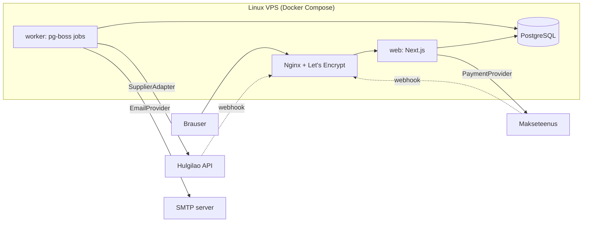

# Arhitektuur

## Põhimõte: modulaarne monoliit

Üks Next.js rakendus, üks PostgreSQL andmebaas ja üks taustatööde worker, mis kasutab **sama koodibaasi**. Kood on jaotatud **äridomeeni järgi** (kataloog, hinnastamine, tarnija, tellimused, maksed), mitte tehnilise kihi järgi.

Miks mitte mikroteenused: üks arendaja, üks server, üks andmebaas. Mikroteenused lisaksid võrgukõnesid, eraldi deploy'sid ja hajusaid tehinguid — keerukust, mis ei too siin kasu. Moodulite piirid on koodis selged, nii et vajadusel saab mõne mooduli hiljem eraldi teenuseks tõsta.



## Arhitektuurireeglid

1. **Brauser ei räägi kunagi tarnijaga.** Andmevoog on alati: tarnija API → worker (sync) → PostgreSQL → Next.js → brauser. Põhjused: API võti jääb serverisse, rate limit'id ei sõltu külastajate arvust, filtrid töötavad meie indeksitel, SEO saab serveris renderdatud HTML-i, ja tarnija downtime ei too poodi maha.
2. **Hinda arvutab ainult server.** Brauser saadab ainult toote ID ja koguse. Hind, tarne ja kogusumma arvutatakse serveris iga kord uuesti.
3. **Välised teenused on liidese (interface) taga.** `SupplierAdapter`, `PaymentProvider`, `EmailProvider`, `ShippingProvider`. Äriloogika ei impordi kunagi konkreetset pakkujat otse.
4. **Tellimuse andmed on snapshot.** `OrderItem` salvestab ostu hetke nime, spetsifikatsiooni, hinna ja KM info — vana tellimus ei muutu, kui toode muutub.
5. **Iga välise sammu jaoks eraldi staatus.** Tellimusel pole `done: boolean`; on `OrderStatus`, `PaymentStatus`, `SupplierOrderStatus`, `ShipmentStatus`.
6. **Idempotentsus.** Iga väline kõrvalmõjuga operatsioon (tarnija tellimus, e-kiri, raha tagastus) kasutab unikaalset võtit, mis salvestatakse **enne** välist kõnet.

## Kaustastruktuur

```
src/
  app/                    Next.js route'id (ainult "liim": loe parameetrid, kutsu teenust, renderda)
    (shop)/...            avalik pood
    admin/login/          admini sisselogimine
    admin/(panel)/...     kaitstud admin (layout kontrollib sessiooni) — vt docs/ADMIN.md
    api/...               route handler'id (autocomplete, webhook'id)
  components/             UI komponendid (vt PROJECT_PLAN.md §6)
  domain/                 puhas äriloogika — ei sõltu Next.js-ist ega andmebaasist, kergesti testitav
    catalog/              tüübid, filtrid, otsing, sorteerimine, facet'id
    grade/                seisukorra klassid
    pricing/              hinnastamismootor
    money/                sentides arvutamine ja vormindamine
    use-cases/            "Leia sobiv" filtrieelistused
    admin/                admini vormide valideerimine, andmekvaliteedi reeglid, hindade eelvaade
    settings/             poe seadete zod-skeemid ja vaikeväärtused
    discounts/            DiscountEngine, koodi normaliseerimine, admini vormi valideerimine
    time/                 Eesti aeg ↔ UTC
  server/                 serveripoolsed teenused ja andmepääs ("server-only")
    catalog/              kataloogi teenus (PostgreSQL või mock) + andmebaasi read → poe kirjed
    cart/                 ostukorvi arvutus serveris
    db/                   Drizzle skeem, ühendus, import (seed)
    auth/                 paroolid, sessioonid, piirang, sisse-/väljalogimine
    admin/                admini päringud (DAL) ja server action'id, audit
    settings/             poe seaded andmebaasist (vahemäluga)
    logging/              struktureeritud logi + system_logs
    discounts/            sooduskoodi laadimine, ostukorvi kontroll, piirang, kasutused (redemptions)
  integrations/           välised süsteemid adapterite taga
    supplier/             SupplierAdapter, normaliseerimine, MockSupplierAdapter
    payment/              PaymentProvider (Phase 6)
    email/                EmailProvider (Phase 7)
    shipping/             ShippingProvider (Phase 5)
  config/                 tehnilised seaded (SITE_URL, hinnastamise algväärtused); poe seaded on andmebaasis
  proxy.ts                admini optimistlik kaitse (Next.js 16 "middleware")
  client/                 brauseripoolsed store'id (ostukorv, võrdlus)
```

Reegel: `domain/` ei impordi kunagi `server/`, `app/` ega `components/`. `components/` ei impordi `server/`-i (andmed tulevad props'ina või server action'i kaudu).

## Kataloogi andmevoog

```
Praegu (andmebaasi etapp):
  import:  MockSupplierAdapter → normaliseerimine → hinnastamine → PostgreSQL (npm run db:seed, idempotentne upsert)
  pood:    PostgreSQL → db-catalog-mapper (efektiivsed väärtused, nähtavus) → 'use cache' + cacheTag('catalog') → lehed
  admin:   server action → valideerimine → tehing (muudatus + audit) → updateTag('catalog') → pood näeb kohe

Ilma DATABASE_URL-ita (lokaalne arendus, CI):
  MockSupplierAdapter → normaliseerimine → hinnastamine → mälus olev kataloog

Järgmine etapp (tarnija sync):
  worker: SupplierAdapter (Foxway) → normaliseerimine → upsert ainult tarnija veergudesse → updateTag('catalog')
```

Lehed ja komponendid ei sõltu andmeallikast: üleminek andmebaasile ei muutnud ühtegi poe komponenti. Andmebaasi viga ei vaheta vaikselt mock-andmetele: see logitakse ja leht näitab veateadet. Tarnija ja admini andmete eraldamine (`manual_overrides`) on kirjeldatud failis [ADMIN.md](ADMIN.md#4-andmete-omanik-tarnija-vs-admin).

## Tootepildid (Icecat)

Pildid kuuluvad **mudelile** (ProductModel, nt "Lenovo ThinkPad T14 Gen 3"), mitte tarnija pakkumisele — kõik sama mudeli konfiguratsioonid kasutavad samu pilte. Tulevikus lisanduvad konkreetse seadme fotod (`ACTUAL_UNIT`) eelistatakse mudelipiltidele.

```
ProductModel (+ tarnija GTIN/MPN + data/icecat/model-identifiers.json)
  → IcecatMatcher      GTIN → MPN + bränd → Icecat ID → (bränd + mudel: ainult käsitsi ülevaatus)
  → pealkirja kontroll Icecati Title peab sisaldama meie bränd + mudelinime (tervete sõnadena)
  → IcecatImageResolver põhipilt (Image) + galerii (Gallery), duplikaadid ja mitte-tootefotod välja
  → allalaadimine      timeout, piiratud retry, Content-Type + faili sisu (magic bytes) kontroll
  → ImageProcessor     sharp: thumbnail 300×300 (contain), medium ≤700, large ≤2000 — WebP, ei suurenda
  → ImageStorageAdapter LocalImageStorageAdapter (arendus) / S3-ühilduv (tootmine, valimata)
  → ProductImageRepository JSON fail (Phase 2: PostgreSQL)
  → frontend           ainult meie URL-id, ; pilte pole → placeholder
```

| Moodul | Fail |
| --- | --- |
| Icecati klient (ainult server, tokenid päistes) | `src/integrations/icecat/icecat-client.ts` |
| Vaste otsimine ja kindlus | `src/integrations/icecat/icecat-matcher.ts`, `src/domain/images/icecat-match.ts` |
| Pildivalik ja variandid | `src/integrations/icecat/icecat-image-resolver.ts` |
| Kontroll ja töötlus | `src/server/images/image-processor.ts` |
| Salvestusruum | `src/server/images/storage/` |
| Import pipeline | `src/server/images/icecat-image-import.ts` |
| Data Quality | `src/server/images/data-quality.ts` |
| Käsurida | `scripts/icecat-images.ts` (`npm run icecat -- …`) |

**Andmeallikate piir (väga oluline)**

| Andmed | Allikas (source of truth) |
| --- | --- |
| CPU, RAM, SSD, GPU, ekraan, puuteekraan, klaviatuur, OS, seisukord, laoseis, hind, garantii, aku | **Tarnija pakkumine** (SupplierListing) |
| Mudeli üldpildid, galerii, Icecati identifikaatorid | **Icecat** |

Icecati vaste on tihti üks konkreetne SKU (nt Saksa klaviatuur, puuteekraan, teine RAM/SSD). Selle tehnilisi andmeid **ei kirjutata kunagi** meie pakkumistesse — `ProductImageRecord` ei sisalda ühtegi tehnilist välja (test kontrollib seda). Mudelitaseme lisaandmeid võib Icecatist võtta ainult eraldi otsusega. Kuna Icecati pildil võib olla teine klaviatuur, kuvatakse galerii juures alati märge *"Tootepildid on illustratiivsed. Seadme tegelik konfiguratsioon ja kosmeetiline seisukord vastavad tootekirjelduses märgitule."* (`ACTUAL_UNIT` piltide puhul seda ei kuvata).

**Staatused**: `MATCHED`, `NEEDS_REVIEW`, `NOT_FOUND`, `ERROR` (+ `REJECTED` admini otsusega) ning täpsustus `reason`: `NO_IDENTIFIERS`, `NOT_IN_ICECAT`, `TITLE_MISMATCH`, `LOW_CONFIDENCE`, `ICECAT_UNAVAILABLE`, `DOWNLOAD_FAILED`.

**Kindlus**: GTIN 1,0 · MPN + tootja 0,95 · teadaolev Icecat ID 0,90 · mudelinimi 0,70 (ei lähe kunagi automaatselt live'i) · admini käsitsi vaste 1,0 (kõrgeim prioriteet).

**Pealkirja kontroll** võrdleb Icecati `Title` välja meie bränd + mudelinimega tervete sõnadena (T14 ≠ T14s, 840 G8 ≠ 840 Aero G8). Teadaolevad erikujud: HP lisab ekraani suuruse ("EliteBook 860 **16** G10"), Dell kirjutab "Latitude 9420 … Hybrid (**2-in-1**)". Kogu kataloogi impordil püüdis see kontroll kinni vale vaste: L14 Gen 2 jaoks leitud Icecat ID osutus ThinkPad **E14** Gen 2-ks → `NEEDS_REVIEW`, pilti live'i ei pandud.

**Galerii kvaliteet**
- Duplikaadid eemaldatakse Icecati pildi ID, URL-i ja **faili sisu (SHA-256)** järgi.
- Mitte-tootefotod (nt 500×49 logoriba) jäetakse mõõtude järgi välja.
- Max 12 pilti mudeli kohta; tootelehel kuni 6 pisipilti + "+N" (ülejäänud täisekraani galeriis); mobiilis punktid kuni 8 pildi korral.
- Admin saab üksiku pildi peita (`isHidden`, nt eksitav klaviatuuri lähivõte). Peitmine säilib ka uuesti allalaadimisel; põhipilt on esimene nähtav pilt.

**Põhipildi valik**: Icecati ametlik HighPic → esimene hea resolutsiooniga (≥ 500 px) galeriipilt → Pic500x500 → LowPic → placeholder.

**Jagatud pildid**: üks Icecati päring ja üks pildikomplekt mudeli kohta. Kõik selle mudeli tarnija pakkumised viitavad samale massiivile (`CatalogProduct.images`) — konfiguratsiooni kohta midagi uuesti alla ei laadita.

**Jõudlus** (production build, mõõdetud 10.10.2026):
- tootekaardi `srcset` sisaldab ainult 300 / 700 px variante — suurt faili kaardile ei laadita;
- esimesed 1–2 nähtavat pilti `loading="eager"` + `fetchPriority="high"`, ülejäänud `lazy`;
- kõigil piltidel `width`/`height` ja fikseeritud kuvasuhtega pildiala → CLS 0;
- avaleht LCP 340 ms; nimekirja algne pildimaht ~54 KB; tooteleht ~98 KB (põhipilt, 2000 px WebP).
- Tootepiltide jaoks kasutatakse ``, mitte `next/image`'it: variandid on juba serveris optimeeritud ja tulevikus asuvad välises salvestusruumis. `unoptimized` ei ole globaalselt sisse lülitatud; logo kasutab `next/image`'it.

**Põhimõtted**

- **Vale pilt on hullem kui placeholder.** Automaatselt läheb live'i ainult vaste kindlusega ≥ 0,9 *ja* kontrollitud pealkirjaga. Muu → `NEEDS_REVIEW`.
- **Icecati JSON API ei toeta nimepõhist otsingut** (ainult GTIN, Brand + ProductCode, icecat_id). Seetõttu on GTIN/MPN tarnija feed'ist kriitilise tähtsusega. Kuni neid pole, kasutatakse käsitsi kogutud koode failis `data/icecat/model-identifiers.json`.
- **Ei hotlinkita.** Icecat nõuab, et pood laeks pildid alla ja hostiks ise; Icecati lingid võivad olla IP-piiratud.
- **Muutumata pilte uuesti alla ei laadita**: võrreldakse Icecati pildi ID-d ja `Updated` aega. Kadunud pildid kustutatakse; teise pildi kasutuses olevat faili üle ei kirjutata.
- **Icecat maas → olemasolevad pildid jäävad alles.** Ajutine viga ei eemalda midagi live'ist.
- **Kontrollitud paralleelsus**: 3 mudelit × 2 pilti korraga; retry ainult 408/429/5xx/võrguvigadel, 404 kunagi.
- **Saladused**: `ICECAT_API_TOKEN` / `ICECAT_CONTENT_TOKEN` ainult HTTP päistes; logger peidab kõik `token|password|secret|key` väljad.

**Salvestusruum ja Vercel — praegune seis**

| Küsimus | Vastus |
| --- | --- |
| Kas veeb kasutab Icecati pildi-URL-e otse (hotlink)? | **Ei.** Frontend kasutab ainult meie URL-e (`/media/products/...`). Icecati URL on andmebaasis ainult viitena (`originalSourceUrl`). |
| Kas pildid laaditakse meie salvestusruumi? | **Jah** — alla laaditud, kontrollitud ja töödeldud (300 / 700 / 2000 px WebP). |
| Kus failid füüsiliselt asuvad? | Arendusarvutis: `public/media/products/<mudel>/` (~45 MB, 323 pilti × 3 varianti) + kirjed `data/media/product-images.json`. Mõlemad on Git'ist välja jäetud. |
| Kas töötab pärast uut Verceli deploy'd? | **Ei.** Faile pole Git'is, seega neid pole ka Verceli buildis → Vercel näitab placeholderit. |
| Kas pildid jäävad alles, kui deploy asendatakse? | Vercelis neid praegu pole. Kui import jookseks Verceli runtime'is, kaoksid failid järgmise deploy'ga (failisüsteem ei ole püsiv) — seetõttu seda ei tehta. |

Tootmises on vaja püsivat S3-ühilduvat salvestusruumi (`S3CompatibleImageStorageAdapter`). Teenus on valimata (vajab omaniku otsust, vt PROJECT_PLAN.md R13). Import jookseb siis serveris/arvutis, failid lähevad salvestusruumi ja kirjed (Phase 2-s) andmebaasi.

## Hulgilao integratsioon

```ts
interface SupplierAdapter {
  readonly code: string;                     // "mock", "supplier-a"
  getProducts(): Promise<SupplierProduct[]>;
  getProduct(externalId: string): Promise<SupplierProduct | null>;
  getAvailability(externalId: string): Promise<SupplierAvailability>; // hind + laoseis koos
  createOrder(input: SupplierOrderInput): Promise<SupplierOrderResult>;
  getOrderStatus(supplierOrderId: string): Promise<SupplierOrderStatus>;
  getTracking(supplierOrderId: string): Promise<TrackingInfo | null>;
}
```

Muudatus algse spetsifikatsiooniga võrreldes: `getStock` ja `getPrice` on ühendatud `getAvailability`-ks, sest checkout'i kontrolliks on vaja mõlemat korraga ja see säästab rate limit'i.

`SupplierProduct` on **tarnija toorandmed** (zod-skeemiga valideeritud). Iga adapter tõlgib oma tarnija formaadi meie normaliseeritud kujule (`NormalizedOffer`) — ülejäänud rakendus tarnija formaati ei näe.

### Sync (Phase 4)

1. Worker käivitab `catalog.sync` töö seadistatud intervalliga (`SystemSetting.syncIntervalMinutes`), singleton-režiimis (kaks sync'i korraga ei jookse).
2. Luuakse `SyncRun` (status `RUNNING`).
3. Tarnijalt loetakse kõik tooted (lehekülgede kaupa, rate limit'i arvestades).
4. Iga toode: valideeri → normaliseeri → leia/loo `Product` + `ProductVariant` → upsert `SupplierListing` → kui ostuhind muutus, kirjuta `PriceHistory` → arvuta müügihind → kui laoseis muutus, kirjuta `StockHistory`.
5. Tooted, mida selles sync'is ei olnud: `SupplierListing.status = MISSING`, laoseis 0. **Ei kustutata.** Kui sama SKU tagasi tuleb, aktiveeritakse uuesti.
6. Vead ei katkesta kogu sync'i: üksiku toote viga → `SyncError` rida, jätkatakse.
7. `SyncRun` lõpetatakse: kestus, loendurid, staatus (`SUCCESS`, `PARTIAL`, `FAILED`).
8. Cache tühistatakse (`revalidateTag('catalog')`).

Kui tarnija API on maas: sync märgitakse `FAILED`, pood töötab edasi viimaste andmetega. Kui viimane edukas sync on liiga vana, kuvab admin hoiatuse ja "Laoseis uuendatud X min tagasi" näitab ausat aega.

## Sooduskoodid (DiscountEngine)

```
brauser:  koodi TEKST + ostukorvi ID-d/kogused ──►  resolveCart(refs, code)  (server action)
server:   hinnad andmebaasist (catalog-service) → kood andmebaasist (normalized_code)
          → ostuhinnad + hinnastamise miinimumkasum (marginaali alampiir)
          → evaluateDiscount(rule, lines, serveri aeg)   ← src/domain/discounts/discount-engine.ts
          → avalik tulemus (summa, põhjus, teade) + kokkusummad
```

Sama `evaluateDiscount` funktsiooni kasutavad ostukorv, admini eelvaade, testid ja tulevikus kassa/tellimus. Klient ei saada kunagi summat. Koodi kontrollimine ei suurenda kasutust: kasutus (`discount_redemptions`) tekib tellimusega ja kinnitatakse maksega. Vt [DISCOUNTS.md](DISCOUNTS.md).

## Hinnastamismootor

Asub `src/domain/pricing/`. Puhas funktsioon, täielikult unit-testitud.

```
ostuhind (neto)
 + transport tarnijalt
 + garantiiriski reserv (% ostuhinnast)
 + juurdehindlus (hinnavahemiku reegel: fikseeritud € ja/või %)
 = neto müügihind
 + käibemaks (tavakord: kogu summalt; erikord: ainult juurdehindluselt)
 + makseteenuse tasu (% + fikseeritud, "gross-up")
 = toorhind
 → ümardamine hinnapsühholoogia reegliga (alati üles, nt 423.62 → 429, 497 → 499)
 → kaitse: kui kasum < minimaalne kasum (€ ja %), tõsta hinda; kui hind ikkagi ebaloogiline → viga, toodet ei müüda
```

Kõik summad sentides. Reeglid tulevad Phase 3-st andmebaasist (`PricingRule`), prototüübis `src/config/pricing.ts`.

## Tellimuse elutsükkel (Phase 5–7)

```
Order.status:          PENDING_PAYMENT → PAID → SUPPLIER_ORDERED → SHIPPED → DELIVERED
                                        ↘ ATTENTION_REQUIRED (admin)  ↘ CANCELLED / REFUNDED
Payment.status:        CREATED → PENDING → PAID | FAILED | CANCELLED → (REFUNDED)
SupplierOrder.status:  QUEUED → SUBMITTING → ACCEPTED → PROCESSING → SHIPPED
                                ↘ FAILED (retry administ)  ↘ UNKNOWN (timeout — kontrolli enne uut katset!)
```

Idempotentsus:

- **Makse webhook** kaks korda: `Payment` uuendatakse tingimusel `status != PAID` (andmebaasi tasemel). Teine kord ei muuda midagi ega loo uut tööd. Webhook'i allkiri verifitseeritakse ja makse staatus kontrollitakse pakkuja API-st üle (ei usaldata ainult webhook'i keha).
- **Tarnija tellimus:** `SupplierOrder` rida luuakse unikaalse `idempotencyKey`-ga (= meie tellimuse number) **enne** API kõnet. Kui kõne timeout'ib → staatus `UNKNOWN`, järgmine samm on `getOrderStatus` meie viite järgi, mitte uus `createOrder`.
- Automaatseid retry'sid on piiratud arv (nt 3, kasvava viivitusega); pärast seda `ATTENTION_REQUIRED` ja admin otsustab.

## Turvalisus (kokkuvõte)

| Oht | Kaitse |
| --- | --- |
| SQL injection | Drizzle'i parameetrid; toor-SQL ainult `sql` template'iga; LIKE metamärgid escape'itakse |
| XSS | React escape'ib; `dangerouslySetInnerHTML` ainult JSON-LD jaoks (serialiseeritud, `<` escape'itud) |
| CSRF | Server Actions kontrollivad Origin päist + oma `assertSameOrigin()` admini toimingutes; admini küpsis SameSite=Strict |
| Hinna võltsimine | Hind arvutatakse alati serveris |
| Sooduskoodi võltsimine | Brauser saadab ainult koodi teksti; summa arvutab server. Äraarvamise piirang 10 ebaõnnestunud katset / 10 min / IP |
| Makse võltsimine | Webhook allkiri + staatus pakkuja API-st |
| Tarnija võltsimine | Tarnija webhook'il jagatud saladus/allkiri; andmed valideeritakse zod-iga |
| Admin | Serveripoolne sessioonikontroll (proxy + layout + iga action), scrypt, andmebaasi sessioonid, rate limit (e-post/IP), audit — vt ADMIN.md |
| Saladused | Ainult `.env` (ei commit'ita), valideeritakse käivitamisel (`src/config/env.ts`) |
| Failid | Admin upload on välja lülitatud, kuni on püsiv salvestus; siis: tüübi ja suuruse kontroll, uus failinimi, ei serveerita käivitatavana |
| Vealeke | Kasutajale ainult vea ID; detail serveri logis ja `system_logs` tabelis |

## Mida me ei kasuta

| Tehnoloogia | Miks mitte praegu |
| --- | --- |
| Redis | pg-boss teeb järjekorra PostgreSQL-is; cache on Next.js-is |
| Elasticsearch / Algolia | PostgreSQL `pg_trgm` + `tsvector` piisab kümnete tuhandete toodete jaoks |
| GraphQL | Server Components loevad andmeid otse; avalikku API-t pole vaja |
| Kubernetes / mikroteenused | Üks server, üks arendaja |
| Event sourcing / CQRS | Staatuste ajalugu salvestame lihtsalt `OrderEvent` tabelisse |

Kui mõni neist kunagi päriselt vajalikuks muutub, on moodulite piirid olemas.
