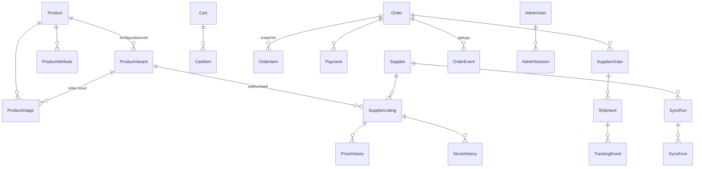

# Andmebaas

PostgreSQL + Prisma. See on **esimene versioon** andmemudelist; lõplik Prisma skeem tehakse Phase 2-s pärast seda, kui andmemudel (PROJECT_PLAN.md, R3) on kinnitatud.

## Põhiotsused

1. **Raha = täisarv sentides** (`Int`, väljanimi lõpeb `Cents`). Ei kasuta `Float`-i.
2. **Product → ProductVariant → SupplierListing** (põhjendus: PROJECT_PLAN.md, R3).
3. **Filtreeritavad väärtused on päris veerud**, mitte JSON: bränd, CPU pere ja põlvkond, RAM, SSD, ekraani suurus, seisukord, klaviatuur, hind, laoseis, kaal ja levinumad omadused (touch, numpad, …). Neile tehakse indeksid.
4. **Haruldased/dünaamilised omadused** (nt "Smart Card lugeja mudel", "kaamera resolutsioon") → `ProductAttribute` tabel (võti-väärtus). Ei pea iga uue omaduse jaoks skeemi muutma, aga põhifiltrid ei sõltu sellest.
5. **Tarnija toorandmed** salvestatakse `SupplierListing.rawData` (JSONB) **ainult silumiseks** — rakendus ei loe sealt kunagi äriloogikat.
6. **Midagi ei kustutata füüsiliselt**, mis on seotud tellimuste või tarnijaga: kasutame `status` välju (`ACTIVE`, `MISSING`, `ARCHIVED`).
7. **Ajalugu** — `PriceHistory`, `StockHistory`, `OrderEvent` on ainult lisatavad (append-only).
8. **Kolme-väärtuseline loogika omadustele:** `Boolean?` — `true` = on, `false` = pole, `null` = teadmata. Filtris kuvatakse omadus ainult siis, kui vähemalt ühel aktiivsel tootel on `true`.

## ER-diagramm (lihtsustatud)



## Mudelid

Allpool on Prisma-laadne mustand (mitte veel lõplik `schema.prisma`).

### Kataloog

```prisma
model Product {                       // mudel: "Lenovo ThinkPad T14 Gen 3"
  id            String   @id @default(cuid())
  slug          String   @unique      // lenovo-thinkpad-t14-gen-3
  brand         Brand                 // LENOVO | DELL | HP | ...
  series        String                // ThinkPad, EliteBook, Latitude
  model         String                // T14 Gen 3
  releaseYear   Int?
  screenSizeIn  Decimal? @db.Decimal(3,1)
  weightKg      Decimal? @db.Decimal(4,2)
  dimensionsMm  String?
  // mudeli tasemel omadused (variandi väärtus kirjutab üle, kui erineb)
  hasThunderbolt Boolean?
  hasHdmi        Boolean?
  hasLan         Boolean?
  hasSdReader    Boolean?
  hasSmartCard   Boolean?
  usbAPorts      Int?
  usbCPorts      Int?
  seoDescription String?
  status        CatalogStatus @default(ACTIVE)
  variants      ProductVariant[]
  images        ProductImage[]
  attributes    ProductAttribute[]
  createdAt     DateTime @default(now())
  updatedAt     DateTime @updatedAt
  @@index([brand, status])
}

model ProductVariant {                // müüdav konfiguratsioon
  id            String   @id @default(cuid())
  productId     String
  sku           String   @unique      // meie SKU
  grade         Grade                 // A_PLUS | A | B | C
  cpuModel      String                // "Intel Core i5-1235U"
  cpuFamily     CpuFamily             // INTEL_CORE_I5 | INTEL_CORE_ULTRA_7 | AMD_RYZEN_7 | ...
  cpuGeneration Int?                  // 12
  ramGb         Int
  ramType       String?               // DDR4, LPDDR5
  storageGb     Int
  storageType   StorageType @default(SSD)
  gpuModel      String?
  gpuDedicated  Boolean  @default(false)
  resolution    String?               // "1920x1080"
  panelType     String?               // IPS, OLED
  isTouch       Boolean?
  isConvertible Boolean?
  keyboardLayout KeyboardLayout?      // SWE | NOR | EST | US | UK | DE | ...
  hasBacklitKeyboard Boolean?
  hasNumpad     Boolean?
  hasFingerprint Boolean?
  hasIrCamera   Boolean?
  hasLte        Boolean?
  has5g         Boolean?
  os            String?
  batteryHealthPct Int?
  chargerIncluded  Boolean?
  // kaupluse andmed — arvutatud aktiivsest SupplierListing'ust
  salePriceCents      Int?
  referencePriceCents Int?            // ainult päris varasem hind (PriceHistory põhjal)
  vatScheme     VatScheme @default(UNKNOWN)
  stockQuantity Int      @default(0)
  isFeatured    Boolean  @default(false)
  firstSeenAt   DateTime @default(now()) // "Värskelt hulgilaost"
  lastSyncedAt  DateTime?
  searchText    String                // normaliseeritud otsingutekst (pg_trgm GIN indeks)
  status        CatalogStatus @default(ACTIVE)
  product       Product  @relation(fields: [productId], references: [id])
  listings      SupplierListing[]
  @@index([status, salePriceCents])
  @@index([status, ramGb])
  @@index([status, storageGb])
  @@index([status, grade])
  @@index([status, cpuFamily, cpuGeneration])
  @@index([firstSeenAt])
}

model ProductImage {                  // pildid kuuluvad MUDELILE; kõik konfiguratsioonid jagavad neid
  id                String      @id @default(cuid())
  productModelId    String                 // = Product.id
  variantId         String?                // ainult ACTUAL_UNIT fotodel (konkreetne seade)
  source            ImageSource            // ICECAT | MANUAL | SUPPLIER | PLACEHOLDER
  sourceId          String                 // nt Icecati galerii pildi ID — uuendamiseks ja duplikaatide vältimiseks
  type              ImageType              // MODEL_GENERIC (illustratiivne) | ACTUAL_UNIT | PLACEHOLDER
  position          Int
  isMain            Boolean @default(false)
  thumbnailUrl      String                 // 300×300 WebP, meie salvestusruumis
  mediumUrl         String                 // ≤700 px WebP
  largeUrl          String                 // ≤2000 px WebP
  width             Int                    // large variandi mõõdud
  height            Int
  alt               String
  originalSourceUrl String                 // Icecati originaal (ainult viide, frontend seda ei kasuta)
  sourceUpdatedAt   String?                // Icecati "Updated" — kui sama, ei laeta uuesti alla
  downloadedAt      DateTime
  storageKeys       String[]               // salvestusruumi võtmed kustutamiseks
  @@unique([productModelId, source, sourceId])
  @@index([productModelId, position])
}

model IcecatMatch {                   // Data Quality: iga mudeli Icecati vaste
  productModelId String  @id
  status         IcecatMatchStatus       // MATCHED | NEEDS_REVIEW | NOT_FOUND | NO_IDENTIFIERS | DOWNLOAD_FAILED | REJECTED
  matchType      IcecatMatchType?        // GTIN | MPN | ICECAT_ID | MODEL_NAME | MANUAL
  confidence     Decimal? @db.Decimal(3,2) // 1.0 / 0.95 / 0.9 / 0.7; live'i ainult ≥ 0.9 + kontrollitud pealkiri
  icecatId       String?
  icecatTitle    String?
  matchedBy      String?                 // nt "GTIN 0196801582675"
  titleVerified  Boolean?
  imageCount     Int     @default(0)
  checkedAt      DateTime
  error          String?
  @@index([status])
}

model ModelIdentifier {               // GTIN/MPN/Icecat ID mudeli kohta (tarnija feed + käsitsi + admini otsused)
  id             String @id @default(cuid())
  productModelId String
  kind           String                  // GTIN | MPN | ICECAT_ID | CONFIRMED_ICECAT_ID | REJECTED_ICECAT_ID
  value          String
  source         String                  // SUPPLIER | CURATED | ADMIN
  @@unique([productModelId, kind, value])
}

model ProductAttribute {              // haruldased omadused
  id        String @id @default(cuid())
  productId String
  variantId String?
  group     SpecGroup                 // PERFORMANCE | DISPLAY | CONNECTIVITY | PHYSICAL | SECURITY | OTHER
  key       String                    // "webcam_resolution"
  label     String                    // "Veebikaamera"
  value     String                    // "1080p"
  @@unique([productId, variantId, key])
}
```

### Tarnija ja sync

```prisma
model Supplier {
  id          String  @id @default(cuid())
  code        String  @unique           // adapteri kood: "mock", "supplier-a"
  name        String
  isActive    Boolean @default(true)
  apiStatus   ApiStatus @default(UNKNOWN) // OK | DEGRADED | DOWN
  lastSuccessfulSyncAt DateTime?
}

model SupplierListing {
  id             String   @id @default(cuid())
  supplierId     String
  variantId      String?               // null = veel sobitamata (admin seob käsitsi)
  externalId     String                // tarnija SKU / ID
  costCents      Int                   // ostuhind (ei jõua kunagi brauserisse)
  costVatScheme  VatScheme
  currency       String   @default("EUR")
  stockQuantity  Int
  status         ListingStatus         // ACTIVE | MISSING | DISABLED
  rawData        Json                  // ainult silumiseks
  contentHash    String                // muudatuste tuvastamiseks
  firstSeenAt    DateTime @default(now())
  lastSeenAt     DateTime
  @@unique([supplierId, externalId])
}

model PriceHistory {
  id            String   @id @default(cuid())
  listingId     String
  costCents     Int
  salePriceCents Int?
  recordedAt    DateTime @default(now())
  syncRunId     String?
  @@index([listingId, recordedAt])
}

model StockHistory { id String @id; listingId String; quantity Int; recordedAt DateTime; syncRunId String? }

model SyncRun {
  id            String    @id @default(cuid())
  supplierId    String
  trigger       SyncTrigger            // SCHEDULED | MANUAL
  status        SyncStatus             // RUNNING | SUCCESS | PARTIAL | FAILED
  startedAt     DateTime  @default(now())
  finishedAt    DateTime?
  durationMs    Int?
  httpStatus    Int?
  itemsRead     Int @default(0)
  itemsCreated  Int @default(0)
  itemsUpdated  Int @default(0)
  itemsOutOfStock Int @default(0)
  errorCount    Int @default(0)
  errors        SyncError[]
}

model SyncError {
  id         String @id @default(cuid())
  syncRunId  String
  externalId String?
  stage      String                     // fetch | validate | normalize | price | save
  message    String
  details    Json?
  createdAt  DateTime @default(now())
}
```

### Ostukorv ja tellimus

```prisma
model Cart {
  id        String @id @default(cuid())  // httpOnly cookie
  items     CartItem[]
  expiresAt DateTime
}
model CartItem { id String @id; cartId String; variantId String; quantity Int; @@unique([cartId, variantId]) }

model Order {
  id             String @id @default(cuid())
  number         String @unique          // meie tellimuse nr, nt "SP-2026-000123" — saadetakse tarnijale viitena
  status         OrderStatus
  email          String
  phone          String
  firstName      String
  lastName       String
  isCompany      Boolean @default(false)
  companyName    String?
  companyRegCode String?
  companyVatNo   String?
  shippingMethod String                  // ShippingProvider kood
  shippingAddress Json                   // snapshot (pakiautomaat või aadress)
  subtotalCents  Int
  shippingCents  Int
  vatCents       Int
  totalCents     Int
  currency       String @default("EUR")
  items          OrderItem[]
  payments       Payment[]
  supplierOrders SupplierOrder[]
  events         OrderEvent[]
  createdAt      DateTime @default(now())
}

model OrderItem {                       // SNAPSHOT — ei sõltu hiljem Product tabelist
  id             String @id @default(cuid())
  orderId        String
  variantId      String?                // viide jääb, aga kuvamiseks kasutatakse snapshot'i
  supplierListingId String?
  title          String
  sku            String
  cpu            String
  ramGb          Int
  storageGb      Int
  grade          Grade
  keyboardLayout String?
  unitPriceCents Int
  unitCostCents  Int                    // ostuhind ostu hetkel (marginaali aruandeks)
  vatScheme      VatScheme
  vatRateBps     Int                    // 2400 = 24%
  vatCents       Int
  quantity       Int
}

model Payment {
  id              String @id @default(cuid())
  orderId         String
  provider        String                // PaymentProvider kood
  providerPaymentId String? @unique
  status          PaymentStatus
  amountCents     Int
  rawWebhook      Json?
  paidAt          DateTime?
}

model SupplierOrder {
  id               String @id @default(cuid())
  orderId          String
  supplierId       String
  idempotencyKey   String @unique       // kaitse duplikaatide vastu
  supplierOrderId  String?
  status           SupplierOrderStatus
  attemptCount     Int @default(0)
  lastError        String?
  lastErrorAt      DateTime?
}

model Shipment { id String @id; supplierOrderId String; carrier String; trackingCode String; trackingUrl String?; status ShipmentStatus; }
model TrackingEvent { id String @id; shipmentId String; status String; description String?; occurredAt DateTime }
model OrderEvent { id String @id; orderId String; type String; message String; data Json?; createdAt DateTime }
```

### Admin ja seaded

```prisma
model AdminUser    { id String @id; email String @unique; passwordHash String; name String; isActive Boolean; lastLoginAt DateTime? }
model AdminSession { id String @id; userId String; tokenHash String @unique; expiresAt DateTime; ip String?; userAgent String? }
model LoginAttempt { id String @id; email String; ip String; success Boolean; createdAt DateTime }  // rate limit

model SystemSetting {                   // võti-väärtus, väärtus valideeritakse zod-skeemiga
  key       String @id                  // "store.trustItems", "shipping.methods", "sync.intervalMinutes"
  value     Json
  updatedAt DateTime @updatedAt
  updatedBy String?
}

model PricingRule {
  id                String @id @default(cuid())
  fromCostCents     Int
  toCostCents       Int?
  markupFixedCents  Int @default(0)
  markupPercentBps  Int @default(0)     // 1500 = 15%
  priority          Int @default(0)
  isActive          Boolean @default(true)
}
```

`SystemSetting` on ainuke koht, kus JSON on põhjendatud: seadeid on vähe, neid ei filtreerita ja iga võtme struktuur valideeritakse koodis zod-skeemiga.

## Otsing

- `ProductVariant.searchText` = normaliseeritud tekst: bränd, seeria, mudel, CPU, SKU, "16gb", "512gb", grade.
- Indeks: `CREATE INDEX ... USING gin (search_text gin_trgm_ops)` (`pg_trgm` laiendus).
- Päring jagab sisendi sõnadeks; iga sõna peab leiduma (AND). "840 g8" → leiab "HP EliteBook 840 G8"; "t14 16 512" → T14 + 16 GB + 512 GB.
- Prototüübis on sama loogika TypeScriptis (`src/domain/catalog/search.ts`) ja unit-testitud.

## Pildid enne PostgreSQL-i (praegu)

Kuni Phase 2-ni hoitakse pildiandmeid JSON failides sama liidese (`ProductImageRepository`) taga:

| Fail | Sisu | Git |
| --- | --- | --- |
| `data/media/product-images.json` | ProductImage kirjed (viitavad kohalikele failidele) | ei (nagu `public/media/`) |
| `data/icecat/matches.json` | IcecatMatch kirjed (Data Quality) | jah — saladusi ega pilte pole |
| `data/icecat/model-identifiers.json` | käsitsi kogutud GTIN/MPN/Icecat ID + admini otsused | jah |

Paralleelsed impordid kirjutavad faile järjekorras (lukk faili kohta) ja atomaarse ümbernimetamisega.

## Migratsioonid ja seed

- `prisma migrate dev` arenduses, `prisma migrate deploy` tootmises (Docker käivitusel).
- Seed loeb `MockSupplierAdapter`-i andmed ja käivitab **sama sync-ahela** — seed andmed läbivad sama koodi kui päris tarnija andmed.
- Varukoopia: igaöine `pg_dump` serveris; dump'e, mis sisaldavad kliendiandmeid, **ei commit'ita** Git'i.
