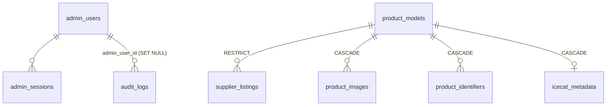
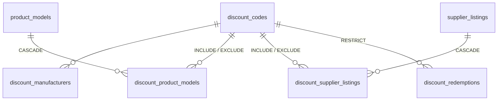

# Andmebaas

**PostgreSQL** (Neon, versioon 18) + **Drizzle ORM**. Skeem on koodis failis [`src/server/db/schema.ts`](../src/server/db/schema.ts) ja migratsioonid kaustas [`drizzle/`](../drizzle/).

> Admini poolt vaadatuna (omanikud, parandused, audit): [ADMIN.md](ADMIN.md).

## ORM valik: Drizzle

Algne plaan oli Prisma (PROJECT_PLAN.md, R12). Andmebaasi etapis valisin **Drizzle ORM-i** (0.45) ja **drizzle-kit**-i (migratsioonid). Põhjused:

| Kriteerium | Drizzle | Prisma |
| --- | --- | --- |
| Stabiilne versioon projekti hetkel | ✅ 0.45 (stabiilne) | `latest` oli 8.0 RC — R12 nõudis stabiilset |
| Serverless (Vercel) | Puhas TypeScript + `pg` draiver, eraldi mootorit pole | Eraldi päringumootor / genereeritud klient, suurem bundle ja külmkäivitus |
| Genereerimise samm | Ei ole: tüübid tulevad otse skeemist | `prisma generate` enne buildi |
| SQL-i läbipaistvus | Päringud on SQL-i lähedased; migratsioon on tavaline SQL fail, mida saab lugeda ja kontrollida | Oma päringukeel; migratsioon samuti SQL |
| JSONB ja keerukamad päringud | Tüübitud `sql\`\`` template parameetritega (nt efektiivne väärtus `manual_overrides ? 'cpu'`) | `$queryRaw` |
| Õppimise väärtus lõputöös | Näha on, milline SQL tegelikult jookseb | Rohkem abstraktsiooni |

Prisma oleks samuti sobinud. Otsustasid stabiilsus, serverless'i sobivus ja SQL-i läbipaistvus.

## Ühendus

- Ühendusstring tuleb keskkonnamuutujast. Vercel + Neon integratsioon lisab muutujad eesliitega `database_` (`database_DATABASE_URL`, `database_DATABASE_URL_UNPOOLED`). Rakendus eelistab `DATABASE_URL`-i ja kasutab muul juhul `database_`-variante (`src/server/db/database-url.ts`).
- Rakendus kasutab **pooled** ühendust (Neon pooler, `max: 5`), migratsioonid ja skriptid **direct** ühendust.
- SSL: `sslmode=require` asendatakse `verify-full`-iga (sertifikaati kontrollitakse).
- Lokaalselt: `vercel env pull .env.development.local` (Git'is ei ole). Ühendusstringi ei kuvata ega logita kunagi; veateadetes asendatakse see `[DATABASE_URL]`-iga.

```bash
npm run db:check      # ühenduse test (versioon, tabelite arv)
npm run db:migrate    # rakenda migratsioonid
npm run db:seed       # impordi praegune kataloog (idempotentne)
npm run db:verify-catalog  # võrdle mock-kataloogi ja andmebaasi kataloogi
npm run db:generate   # uus migratsioon pärast schema.ts muutmist
```

## Põhiotsused

1. **Raha = täisarv sentides** (`integer`, väljanimi lõpeb `Cents`). Ujukomaarve ei kasutata.
2. **ProductModel → SupplierListing.** Mudel kannab pilte, identifikaatoreid ja kirjeldust; pakkumine kannab konkreetset konfiguratsiooni, laoseisu ja hinda.
3. **Puuduv tarnija väärtus = `NULL`**, mitte väljamõeldud vaikeväärtus. UI näitab "Puudub" ja Andmekvaliteet näitab probleemi.
4. **Tarnija veerud + `manual_overrides` JSONB.** Efektiivne väärtus = parandus ?? tarnija väärtus. Sync kirjutab ainult tarnija veerge (vt ADMIN.md §4).
5. **Staatused tekstiveeruna + CHECK** (mitte PostgreSQL enum). Uue väärtuse lisamine ei vaja `ALTER TYPE`-i ja tüübid tulevad TypeScripti konstantidest (`CATALOG_STATUSES` jne).
6. **Midagi ei kustutata füüsiliselt** kataloogist: kasutatakse staatusi `ACTIVE` / `HIDDEN` / `ARCHIVED`.
7. **Looduslikud unikaalsed võtmed** teevad impordi idempotentseks: mudel → `slug`; pakkumine → `(supplier, supplier_product_id)`; pilt → `(product_model_id, source, source_id)`; identifikaator → `(product_model_id, kind, value)`.
8. **Audit samas tehingus** muudatusega.

## Tabelid



Lisaks on seosteta tabelid `login_attempts`, `pricing_rules`, `store_settings` ja `system_logs`.

Sooduskoodid (migratsioon `0001_discount_codes.sql`, kirjeldus failis [DISCOUNTS.md](DISCOUNTS.md)):



| Tabel | Sisu | Olulised väljad |
| --- | --- | --- |
| `admin_users` | Admini kasutajad | `email` (unikaalne), `password_hash` (scrypt), `role`, `is_active`, `last_login_at` |
| `admin_sessions` | Sessioonid | `token_hash` (SHA-256, unikaalne), `expires_at`, `last_seen_at`, `ip`, `user_agent` |
| `login_attempts` | Sisselogimiskatsed (piirang) | `email`, `ip`, `success`, `created_at` (indeksid e-post + aeg, IP + aeg) |
| `product_models` | Tootemudelid | `slug` (unikaalne), `manufacturer`, `family`, `model`, `generation`, `screen_size_in`, `weight_kg`, pordid, `wifi`, `bluetooth`; admin: `description`, `featured`, `status`, `manual_overrides` |
| `product_identifiers` | GTIN, MPN, Icecat ID-d ja admini otsused | `kind` (GTIN / MPN / ICECAT_ID / CONFIRMED_ICECAT_ID / REJECTED_ICECAT_ID), `value`, `source` (SUPPLIER / CURATED / ADMIN) |
| `supplier_listings` | Tarnija pakkumised (konfiguratsioonid) | tarnija veerud (CPU, RAM, SSD, GPU, ekraan, klaviatuur, seisukord, OS, garantii, aku, laadija, laoseis, tarneaeg, ostuhind, KM režiim, `raw_data`); admin: `sale_price_cents`, `status`, `manual_overrides`; `sku` (meie, unikaalne), `first_seen_at`, `last_synced_at` |
| `product_images` | Mudelipildid | `source`, `source_id`, `position`, `is_main`, `is_hidden`, `thumbnail_path` / `medium_path` / `large_path`, mõõdud, `alt`, `content_hash`, `storage_keys` |
| `icecat_metadata` | Icecati vaste mudeli kohta | `status` (MATCHED / NEEDS_REVIEW / NOT_FOUND / ERROR / REJECTED), `reason`, `match_type`, `confidence`, `icecat_id`, `icecat_title`, `matched_by`, `title_verified`, `image_count`, `checked_at` |
| `pricing_rules` | Juurdehindluse vahemikud | `from_cost_cents`, `to_cost_cents` (NULL = piiranguta), `markup_fixed_cents`, `markup_percent_bps`, `position` |
| `store_settings` | Poe seaded (võti → JSONB) | `key` (general, store, delivery, warranty, returns, trustBar, pricing), `value` (zod-valideeritud), `updated_by` |
| `audit_logs` | Tegevuslogi | `admin_email`, `action`, `entity_type`, `entity_id`, `entity_label`, `changes` (`{väli:{from,to}}`) |
| `discount_codes` | Sooduskoodid | `code` (kuvamiseks), `normalized_code` (UNIQUE), `type`, `value` (bps/sendid), `status`, `active` (tuletatud veerg), `starts_at`, `expires_at`, `minimum_subtotal_cents`, `maximum_discount_cents`, `usage_limit`, `usage_count`, `scope`, `respect_minimum_margin`, `created_by`, `updated_by` |
| `discount_manufacturers`, `discount_product_models`, `discount_supplier_listings` | Millele kood kehtib / mis on välistatud | `mode` INCLUDE / EXCLUDE, välisvõtmed tootele |
| `discount_redemptions` | Koodi kasutused tellimustes (valmis tellimuste süsteemiks) | `order_id`, `status` PENDING / CONFIRMED / CANCELLED, snapshot-väljad; UNIQUE (kood, tellimus) |
| `discount_validation_attempts` | Ebaõnnestunud koodikatsed (piirang) | `ip`, `success`, `created_at` |
| `system_logs` | Süsteemilogi | `level` (DEBUG / INFO / WARN / ERROR), `source` (APPLICATION / DATABASE / ADMIN / AUTH / ICECAT), `message`, `details`, `error_id` |

`store_settings` on koos `manual_overrides`-iga ainus koht, kus JSON on põhjendatud. Seadeid on vähe, neid ei filtreerita ja iga võtme struktuur valideeritakse zod-skeemiga. Filtreeritavad väärtused (RAM, SSD, seisukord, hind …) on päris veerud.

## Migratsioonid

- `drizzle/0000_init.sql`: algne skeem (12 tabelit, indeksid, CHECK piirangud, välisvõtmed).
- `drizzle/0001_discount_codes.sql`: sooduskoodid (6 tabelit). Lisab ainult uusi tabeleid, olemasolevaid ei muuda. Kokku on 18 tabelit.
- Migratsioonide ajalugu on tabelis `public.__drizzle_migrations`.
- Uus muudatus: muuda `schema.ts` → `npm run db:generate` → vaata genereeritud SQL üle → `npm run db:migrate`.
- Migratsiooni SQL commit'itakse Git'i (`.gitignore`-is on erand `!/drizzle/*.sql`).

## Kataloogi import (seed)

`npm run db:seed` loeb praegused allikad (`src/server/db/seed/seed-sources.ts`): mock-tarnija, pildikirjed (`data/media/product-images.json`), Icecati vasted (`data/icecat/matches.json`), käsitsi kogutud identifikaatorid ja hinnareeglid. Seejärel kirjutab need andmebaasi (`seed-catalog.ts`).

Tulemus (2026-10-10):

| | Allikas (ENNE) | Andmebaas (PÄRAST) |
| --- | --- | --- |
| Mudeleid | 38 | 38 |
| Konfiguratsioone | 46 | 46 |
| Pilte | 320 | 320 |
| Icecat MATCHED / NOT_FOUND / NEEDS_REVIEW | 34 / 3 / 1 | 34 / 3 / 1 |
| Identifikaatoreid | – | 123 |

- **Idempotentne:** korduv import ei tekita duplikaate (testitud).
- **Admini muudatused jäävad alles:** korduv import uuendab ainult tarnija veerge. Staatus, esiletõstmine, kirjeldus, parandused, müügihind ja piltide järjekord/peitmine seatakse ainult esmasel lisamisel (testitud).
- `npm run db:verify-catalog` võrdleb mock-kataloogi ja andmebaasist ehitatud poe kataloogi: 46/46 pakkumist, samad ID-d, hinnad, CPU/RAM/SSD, seisukorrad, laoseisud ja pildid.

## Pood ja andmebaas

`src/server/catalog/catalog-service.ts` on ainus koht, kust poe lehed andmeid küsivad:

- Kui `DATABASE_URL` on seadistatud: andmebaas → `db-catalog-mapper.ts` (efektiivsed väärtused, nähtavus, kohustuslikud väljad) → `'use cache'` + `cacheTag('catalog')`.
- Kui ei ole (lokaalne arendus ilma DB-ta, CI): mock-tarnija mälus.
- Andmebaasi viga **ei vaheta vaikselt mock-andmetele**: see logitakse (`system_logs`, vea ID) ja kasutaja näeb veateadet.

## Pildid ja Icecat

Pildikirjed ja Icecati vasted on andmebaasis (`product_images`, `icecat_metadata`). Icecati import kasutab `DbImageRepository`-t (sama `ProductImageRepository` liides, mis varem JSON-failidel). Pildifailid ise on testversioonis `public/media/products/` all Git'is. Püsiv objektisalvestus on PROJECT_PLAN.md R13.

> `npm run icecat` (CLI) kasutab veel JSON-faile ja sobib esialgseks massimpordiks. Pärast andmebaasi kasutuselevõttu tehakse üksikmudelite toimingud adminis. CLI viimine `DbImageRepository` peale on järgmise etapi töö.

## Tulevased tabelid (veel loomata)

Andmemudel on valmis neid vastu võtma (UUID võtmed, `supplier` veerg, snapshot-põhimõte):

- `suppliers`, `sync_runs`, `sync_errors`: tarnija ühendus ja sync (Foxway)
- `customers`, `orders`, `order_items` (hinna- ja spetsifikatsiooni **snapshot**, ei sõltu hiljem kataloogist), `payments`. Tellimus salvestab ka sooduskoodi snapshot'i ja `discount_redemptions.order_id` saab välisvõtme
- `supplier_orders` (idempotentsusvõti duplikaatide vastu), `shipments`, `tracking_events`
- `price_history`, `stock_history` (ainult lisatavad)

Need luuakse koos vastava funktsionaalsusega, mitte ette, et skeemis ei oleks kasutamata tabeleid.

## Otsing

Otsing ja filtrid töötavad praegu rakenduse mälus (kataloog on väike: kümned või sajad pakkumised) ja on unit-testitud (`src/domain/catalog/search.ts`, `filtering.ts`). Kui kataloog kasvab tuhandetesse, liigub otsing PostgreSQL-i (`pg_trgm` GIN indeks normaliseeritud otsingutekstil).

## Varukoopia

Neon teeb automaatseid varukoopiaid (point-in-time restore). Andmebaasi dump'e, mis sisaldavad kliendiandmeid, **ei commit'ita** Git'i.
