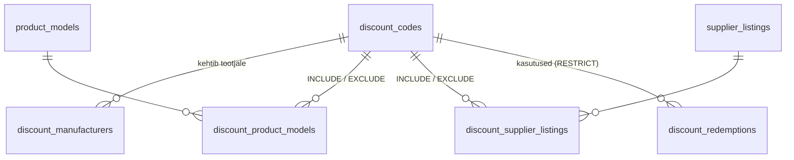

# Sooduskoodid

Sooduskoodide süsteem on ehitatud nii, et seda saab kohe kasutada ka siis, kui poodi lisanduvad päris tellimused ja maksed. Dokument kirjeldab andmemudelit, valideerimist, arvutuse järjekorda, kehtivusaega, kasutuspiirangut, turvalisust, tulevast tellimuste integratsiooni ja marginaalikaitset.

> Seotud: [ADMIN.md](ADMIN.md) (admin-liides), [DATABASE.md](DATABASE.md) (skeem), [ARCHITECTURE.md](ARCHITECTURE.md).

## 1. Põhimõtted

1. **Üks arvutusmootor.** Kogu loogika on ühes puhtas funktsioonis `evaluateDiscount()` (`src/domain/discounts/discount-engine.ts`). Seda kasutavad ostukorv, admini eelvaade, testid ja tulevikus kassa ning tellimuse loomine. Arvutust ei korrata komponentides.
2. **Klient ei määra kunagi soodustuse summat.** Brauser saadab ainult koodi **teksti**. Server loeb hinnad andmebaasist, leiab koodi, kontrollib tingimusi ja arvutab summa ise.
3. **Kontrollimine ei ole kasutamine.** Koodi sisestamine ostukorvis ei suurenda kasutuste arvu. Kasutus loetakse alles kinnitatud tellimusest.
4. **Kasutatud koode ei kustutata.** Kood arhiveeritakse, ajalugu ja tellimuste viited jäävad alles.
5. **Server otsustab aja.** Kehtivust kontrollitakse serveri UTC-kella järgi, mitte kliendi brauseri kella järgi.

## 2. Andmemudel



### `discount_codes`

| Väli | Tähendus |
| --- | --- |
| `code` | Admini sisestatud kuju kuvamiseks (nt `Sügis10`) |
| `normalized_code` | **UNIQUE**. Võrdlemiseks: trim + Unicode NFKC + suurtähed → `SÜGIS10` |
| `name`, `internal_description` | Kampaania nimi ja admini märkmed (kliendile ei näidata) |
| `type` | `PERCENTAGE` / `FIXED_AMOUNT` / `FREE_SHIPPING` |
| `value` | PERCENTAGE: **baaspunktid** (1000 = 10%, nii saab ka 12,5%). FIXED_AMOUNT: **sendid**. FREE_SHIPPING: 0 |
| `status` | Admini määratud: `DRAFT` / `ACTIVE` / `DISABLED` / `ARCHIVED` |
| `active` | **Tuletatud veerg** `GENERATED ALWAYS AS (status = 'ACTIVE')`, mis ei saa staatusega vastuollu minna |
| `starts_at`, `expires_at` | `timestamptz` (UTC), mõlemad valikulised. CHECK: lõpp > algus |
| `minimum_subtotal_cents`, `maximum_discount_cents` | Valikulised (NULL = piiranguta) |
| `usage_limit`, `usage_count` | Piirang (NULL = piiranguta) ja **kinnitatud** kasutuste arv |
| `scope` | `ALL_PRODUCTS` / `SELECTED_MANUFACTURERS` / `SELECTED_PRODUCT_MODELS` / `SELECTED_LISTINGS` |
| `respect_minimum_margin` | Marginaalikaitse, vaikimisi **true** |
| `created_by`, `updated_by`, `created_at`, `updated_at` | Kes ja millal |

### Seosetabelid (mitte JSON)

- `discount_manufacturers (discount_code_id, manufacturer)`: valitud tootjad (`lenovo`, `dell`, `hp`).
- `discount_product_models (discount_code_id, product_model_id, mode)`: `mode = INCLUDE` (kehtib) või `EXCLUDE` (välistatud).
- `discount_supplier_listings (discount_code_id, supplier_listing_id, mode)`: sama konfiguratsioonide jaoks.

Struktureeritud seosed on parem lahendus kui üks JSON-veerg. Välisvõtmed tagavad, et kood ei viita olematule tootele (kustutamisel `CASCADE`). Unikaalsed indeksid väldivad topeltvalikuid. Andmebaas saab ise vastata küsimusele „millised koodid puudutavad seda toodet“.

### `discount_redemptions` (tulevik)

| Väli | Tähendus |
| --- | --- |
| `discount_code_id` | Viide koodile (`ON DELETE RESTRICT`: kasutatud koodi ei saa kustutada) |
| `order_id` | Tellimus. Välisvõti lisatakse koos `orders` tabeliga |
| `status` | `PENDING` (reserveeritud) / `CONFIRMED` (makstud) / `CANCELLED` |
| `code_snapshot`, `type_snapshot`, `value_snapshot`, `discount_amount_cents`, `snapshot` | **Ajalooline koopia** tolle hetke väärtustest |

UNIQUE `(discount_code_id, order_id)`: sama tellimus ei saa sama koodi kaks korda kasutada.

### `discount_validation_attempts`

Ebaõnnestunud kontrollid IP kaupa (piirang botide vastu). Vanemad kui 24 h kustutatakse automaatselt.

## 3. Koodi normaliseerimine

```
" Sügis10 "  →  trim  →  NFKC  →  toLocaleUpperCase("et-EE")  →  "SÜGIS10"
```

- `GARANTII`, `garantii` ja `Garantii` on sama kood. Andmebaasi UNIQUE indeks `normalized_code` peal ei luba neid eraldi luua.
- Lubatud: tähed (ka õ, ä, ö, ü, š, ž), numbrid, `-` ja `_`, pikkus 3–40. Tühikuid koodi sees pole.
- NFKC teisendab ka visuaalselt sarnased märgid (nt täislaiusega `ＫＯＯＬ７５` → `KOOL75`).
- „Genereeri kood“ loob näiteks `SAVE-X7K4P2`. Kasutatakse krüptograafilist juhuslikkust ja tähestikku ilma segiaetavate märkideta (0/O, 1/I/L). Juhuslikkus on ühtlane, sest kasutatakse tagasilükkamisega valimit.
- Ka arhiveeritud koodi teksti ei saa uuesti kasutada. Nii ei teki kunagi kahte erineva sisuga koodi, mille tekst on sama (vanade tellimuste ajalugu jääb üheselt mõistetavaks).

## 4. Arvutuse järjekord

`evaluateDiscount(rule, cartLines, now)`:

| # | Samm | Kui ei sobi |
| --- | --- | --- |
| 1 | Olek: `DRAFT` / `ARCHIVED` | „Sooduskoodi ei leitud.“ (koodi olemasolu ei reedeta) |
| | Olek: `DISABLED` | „See sooduskood ei ole hetkel aktiivne.“ |
| 2 | Algus tulevikus | „Sooduskood ei ole veel aktiivne.“ |
| | Lõpp möödas | „Sooduskood on aegunud.“ |
| 3 | `usage_count >= usage_limit` | „See sooduskood ei ole hetkel aktiivne.“ |
| 4 | Ostukorv tühi | „Ostukorv on tühi.“ |
| 5 | Sobivad read (kehtivusala, seejärel välistused) | „Sooduskood ei kehti ühelegi ostukorvis olevale tootele.“ |
| 6 | Miinimumsumma (kogu ostukorvi toodete summa) | „Sooduskoodi kasutamiseks peab ostukorvi summa olema vähemalt 700 €.“ |
| 7 | Toorsoodustus: % sobivast summast (ümardatud sendini) või fikseeritud summa; maksimum; **mitte rohkem kui sobiv summa** | |
| 8 | Jaotus sobivatele ridadele proportsionaalselt (suurima jäägi meetod, sendid klapivad täpselt) | |
| 9 | Marginaalikaitse rea kaupa (vt §9) | „Sooduskoodi ei saa ostukorvis olevatele toodetele rakendada.“ |
| 10 | Kokkusumma = vahesumma − soodustus, **alati ≥ 0** | |

Näited (kõik on automaattestides):

| Kood | Ostukorv | Tulemus |
| --- | --- | --- |
| `SÜGIS10` 10% | 500 € | −50 € → 450 € |
| `KOOL75` 75 € | 500 € | −75 € → 425 € |
| 10%, max 100 € | 1500 € | 150 € → piiratud **100 €** |
| `KOOL75` 75 € | 50 € | −50 € → **0 €** (mitte negatiivne) |
| `SAVE100`, min 700 € | 650 € / 750 € | kehtetu / −100 € |
| `DELL10` 10% ainult Dell | Lenovo 500 € + Dell 500 € | **−50 €** (ainult Delli osa) |

**Miks miinimumsumma arvestab kogu ostukorvi?** Kliendile kuvatav tingimus on „ostukorvi summa vähemalt X €“. Soodustus ise arvutatakse ainult sobivatelt toodetelt.

**Tasuta tarne** (`FREE_SHIPPING`): mootor toetab seda (`freeShipping: true`, toodete summa ei muutu). Ostukorvis näidatakse koodi kehtivust ja „tasuta (kassas)“. Tarneviisi ja -hinda valitakse alles kassas, mida veel pole, seega ei teeselda, et tarne oleks juba ostukorvis tasuta arvestatud.

## 5. Millele kood kehtib

| Kehtivusala | Admin valib | Rida sobib, kui |
| --- | --- | --- |
| Kõik tooted | – | alati |
| Valitud tootjad | Lenovo / HP / Dell | mudeli tootja on valitute hulgas |
| Valitud mudelid | otsinguga mudelid | rea mudel on valitute hulgas |
| Valitud konfiguratsioonid | otsinguga konfiguratsioonid | rea pakkumine on valitute hulgas |

**Välistused** (mudelid ja konfiguratsioonid) on **alati ülimuslikud**. Näiteks „10% kogu poele, aga üks väga väikese marginaaliga toode on välistatud“.

Andmebaasis on valikud ID-dena (välisvõtmetega). Mootorile antakse need stabiilsete võtmetena (mudeli slug, pakkumise SKU), mida tunneb ka poe ostukorv.

## 6. Kehtivusaeg ja ajavöönd

- Andmebaasis on `timestamptz` (UTC).
- Admin sisestab ja näeb **Eesti aega** (Europe/Tallinn, suveaeg UTC+3, talveaeg UTC+2), sõltumata serveri (Vercel = UTC) või brauseri ajavööndist. Teisendus on failis `src/domain/time/tallinn.ts` ja arvestab suveaja vahetust. Näide: `31.10.2026 23:59` → `2026-10-31T21:59Z`.
- Kehtivuse otsustab **server** oma kella järgi (`new Date()` serveris, admini nimekirjas andmebaasi `now()`). Brauseri kella ei kasutata.
- **Tegelik olek** arvutatakse, seda ei määrata käsitsi:

| Admini olek | Kuupäevad | Tegelik olek (admini tabelis) |
| --- | --- | --- |
| ACTIVE | algus tulevikus | **SCHEDULED** (Ajastatud) |
| ACTIVE | lõpp möödas | **EXPIRED** (Aegunud) |
| ACTIVE | muidu | ACTIVE |
| DRAFT / DISABLED / ARCHIVED | – | sama |

Sama loogika on TypeScriptis (`effectiveDiscountStatus`) ja SQL-is (`effectiveStatusSql`, filtrite ja töölaua jaoks).

## 7. Kasutuspiirang ja tulevane tellimuste integratsioon

`usage_count` **ei kasva** koodi kontrollimisel (testitud). Kasutuse elutsükkel on failis `src/server/discounts/redemptions.ts`:

```
tellimuse loomine (tehing)
  1. evaluateDiscount() uuesti serveris (hinnad andmebaasist)
  2. reserveRedemption(): SELECT … FOR UPDATE koodi real
       → PENDING + CONFIRMED >= usage_limit ? viga : lisa PENDING koos snapshot'iga
makse kinnitatud (webhook)
  3. confirmRedemption() → CONFIRMED, usage_count = kinnitatud kirjete arv (mitte +1 → alati õige ja idempotentne)
tellimus tühistatud / makse ebaõnnestus
  4. cancelRedemption() → CANCELLED, koht vabaneb
```

- **Rea lukk** (`FOR UPDATE`) välistab olukorra, kus kaks samaaegset tellimust kasutavad viimast vaba kohta mõlemad.
- Reserveering (PENDING) loeb piirangusse, et makse ajal ei saaks keegi teine sama kohta võtta.
- Korduv kinnitus (nt makseteenuse korduv webhook) ei loe kasutust topelt (testitud).
- Funktsioonid on valmis ja testitud, aga poes veel kasutamata, sest tellimusi pole. Admin näeb kasutust kujul `0 / 500` ja selgitust, et kasutuste arvestus käivitub koos tellimuste süsteemiga.

### Snapshot

Tellimus salvestab **koopia**, mitte ainult viite koodile:

```json
{ "code": "KOOL75", "normalizedCode": "KOOL75", "type": "FIXED_AMOUNT", "value": 7500,
  "maximumDiscountCents": null, "minimumSubtotalCents": 70000,
  "eligibleSubtotalCents": 53900, "discountAmountApplied": 7500, "freeShipping": false,
  "lines": [{ "listing": "SP-10231", "discountCents": 7500 }] }
```

Admin võib koodi hiljem muuta, välja lülitada või arhiveerida, aga vana tellimus säilitab tolle hetke info (`buildDiscountSnapshot`). Ridade jaotus on vajalik tagastuste jaoks: kui klient tagastab ühe toote, on teada, kui suur osa soodustusest sellele reale langes.

## 8. Turvalisus

| Oht | Kaitse |
| --- | --- |
| Klient võltsib summat | Server ei loe brauserist summat ega hinda (ainult ID-d, kogused ja koodi tekst). Testitud: lisaväljad `discountAmountCents`, `priceCents` jäetakse kõrvale |
| Mitu koodi korraga | API võtab vastu ühe stringi. Massiiv või objekt → soodustust pole (testitud). UI-s: „Ostukorvis saab korraga kasutada ühte sooduskoodi“ |
| Koodide äraarvamine | Piirang: 10 ebaõnnestunud katset / 10 min / IP (andmebaasis, töötab ka mitme serverless-instantsi vahel). Seejärel „Liiga palju katseid…“ |
| Koodi olemasolu lekkimine | Mustand, arhiveeritud ja olematu kood annavad sama vastuse („Sooduskoodi ei leitud.“). Väljalülitatud ja täis piiranguga kood annavad sama üldise vastuse. Täpsemad põhjused (aegunud, pole alanud, miinimumsumma) on ainult seal, kus kliendil on neid vaja |
| Admini info lekkimine | Avalik vastus sisaldab ainult `valid, code, eligibleSubtotalCents, discountAmountCents, freeShipping, reason, message` (testitud). Märkmeid, piirangut ja kasutusi ei saadeta |
| Sisemine viga | Kliendile üldine eestikeelne teade; detail läheb `system_logs` tabelisse vea ID-ga |
| Admini muudatused | Iga toiming kontrollib sessiooni ja päritolu (`runAdminAction`), valideerib serveris (sama zod-skeem mis brauseris) ja kontrollib, et valitud mudelid/konfiguratsioonid on olemas |
| Kahekordne kood | `normalized_code` UNIQUE + kontroll enne salvestust + andmebaasi vea `23505` käsitlus |

## 9. Marginaalikaitse

Hinnastamises on olemas miinimumkasumi reeglid (`minProfitCents`, `minProfitBps`, `minSalePriceCents`, admin → Hinnastamine). Sooduskood ei tohiks viia toote hinda alla piiri, kus pood kaotab raha.

- `minimumAllowedPrice(config, { costCents, vatScheme })` (`src/domain/pricing/pricing-engine.ts`) leiab kahendotsinguga **madalaima müügihinna**, mille juures toode veel vastab miinimumkasumile. Kasutatakse **sama kasumiarvutust** (KM, makse-, garantii- ja tarnekulu) mis `calculatePrice`-is, nii et uut ega väljamõeldud reeglit ei teki.
- Kui koodil on `respect_minimum_margin = true` (vaikimisi), piirab mootor iga rea soodustust: `max(0, ühikuhind − madalaim lubatud hind) × kogus`.
- Kui ostuhind või käibemaksurežiim puudub, on rida „marginaal kontrollimata“: soodustust ei piirata ja eelvaade näitab seda selgelt.
- Admini eelvaade näitab näiteks: „1 toote soodustust vähendati, sest allahindlus oleks viinud hinna alla minimaalse lubatud marginaali.“

**Päris näide testandmetest:** Dell Latitude 5430 (SP-20110) müügihind on 489,00 €, ostuhind 300,00 € (tavakäibemaks) ja madalaim lubatud hind 447,47 €. Kood `DELL10` (10%) annaks 48,90 €, aga marginaalikaitse piirab soodustuse **41,53 €**-ni. Kui admin soovib anda täpselt 10%, tuleb koodil marginaalikaitse välja lülitada ja kahjum teadlikult aktsepteerida.

## 10. Ostukorvi kasutajakogemus

```
Vahesumma                1028 €
Sooduskood DELL10      −41,53 €
Transport            alates 3,99 €
[ DELL10 ✓   −41,53 €  ]  Eemalda
Kokku                  986,47 €
```

- Sisestusväli on 44 px kõrge, mobiilis 16 px fondiga (iOS ei suumi). Nupp „Rakenda“ on kõrval ja veateade murdub ridadeks ilma paigutust lõhkumata.
- Brauserisse salvestatakse ainult koodi tekst (`localStorage`, `cart:discount:v1`). Pärast lehe värskendamist kontrollib server koodi uuesti.
- Kui salvestatud kood enam ei kehti (aegus, ostukorv langes alla miinimumi, admin lülitas välja), eemaldatakse see automaatselt ja kuvatakse põhjus. Näiteks: „Sooduskood eemaldati: Sooduskoodi kasutamiseks peab ostukorvi summa olema vähemalt 700 €.“
- Kehtiva koodi korral on sisestusväli peidetud: korraga saab kasutada ühte koodi.

## 11. Admin

`/admin/discounts`: nimekiri (kood, nimi, tüüp, soodustus, kehtivus, kasutus, tegelik staatus, muudetud) koos otsingu, filtrite (staatus, tüüp) ja järjestusega. Kiirtoimingud: muuda, duplikeeri, aktiveeri / lülita välja, arhiveeri (kinnitusega). Vaata [ADMIN.md](ADMIN.md#14-sooduskoodid).

- **Olekuüleminekud:** DRAFT → ACTIVE, ACTIVE ⇄ DISABLED, kõik → ARCHIVED. Arhiveeritud koodi ei saa muuta ega aktiveerida.
- **Duplikaat** on alati **MUSTAND** uue koodiga (`KOOL75` → `KOOL75-COPY`, `-COPY2` …) ja samade reeglitega.
- **Kasutatud koodi teksti ei saa muuta** (`usage_count > 0`).
- **Audit:** `discount.create` (kõik väärtused), `discount.update` (ainult muutunud väljad, sh valikute nimekirjad), `discount.activate`, `discount.disable`, `discount.archive`, `discount.duplicate`. Ostukorvi kontrolle auditisse ei kirjutata.
- **Töölaud:** aktiivsed / ajastatud / aegunud koodid. Säästetud summat ega käivet ei näidata enne päris tellimusi.

## 12. Testid

| Fail | Mida kontrollib |
| --- | --- |
| `src/domain/discounts/discounts.test.ts` (31) | Tõstutundetus, vorming, genereerimine, %, €, maksimum, negatiivne summa, miinimumsumma, kuupäevad, tegelik olek, välja lülitatud/arhiveeritud/mustand, kasutuspiirang (kontroll ei muuda), tootja/mudel/konfiguratsioon, välistused, jaotus, tasuta tarne, marginaalikaitse, snapshot, ajavöönd, admini vorm |
| `src/server/discounts/discounts.db.test.ts` (15) | Päris PostgreSQL: loomine + audit, UNIQUE, muutmise audit (vana → uus), duplikaat, olekud, admini õigused, ostukorvi serveripoolne arvutus, kliendi võltsimine, kasutus ei kasva, aegunud/tulevane/välja lülitatud/arhiveeritud, piirang IP kaupa, eelvaade, marginaal päris ostuhinnaga, reserveeri/kinnita/tühista |
